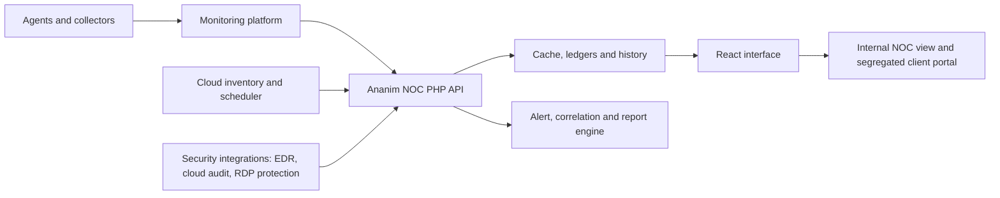
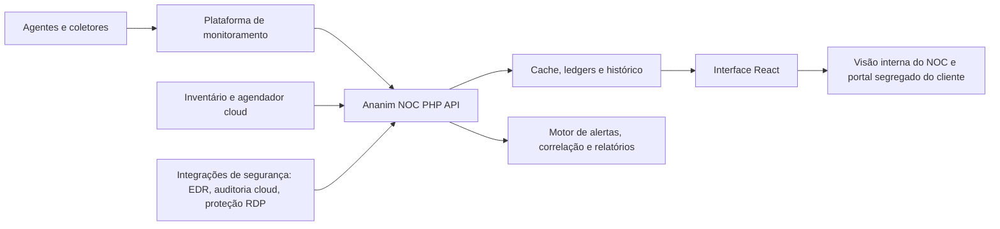

# Architecture — Ananim NOC

[English](#english) · [Português](#português)

## English

Logical diagram — no addresses, credentials or client topology.

### From collection to investigation

Sources provide metrics, Windows events, service and process signals, AD account inventory and session observations. The portal ties each piece to a client, a host and a time window. The correlation flow builds time-based episodes, recurrences and server-role context, and the UI lets operators compare technical signals with user and session history — keeping observation, hypothesis and confirmed cause separate.

### Engineering decisions

- **Context-aware availability** — the expected window combines schedules (cloud scheduler, learned patterns, tags) and evidence of operation; an agent that stops answering is not automatically a server outage.
- **Persistent ledgers** — histories and ledgers preserve observations between collections; reprocessing keeps traceability.
- **Explainable correlation** — operators see the events and timestamps behind a hypothesis instead of a "cause" presented as certainty.
- **Tenant isolation in the backend** — data scope is validated server-side, not only by UI filters; the client portal has its own users and MFA.
- **White-label by configuration** — branding, tenants, cloud accounts and integrations are configuration, so the same build can serve any company or run as SaaS.
- **Secrets stay server-side** — API keys for EDR, cloud and other integrations are never sent to the browser; integrations are proxied.

### Validation

Changes are validated at separate levels: syntax/build, isolated tests, deployment and real behavior with real data. A started process, an HTTP 200 or an enabled button does not prove the expected result on its own.

### Limits

- Visibility depends on active collectors, permissions and source retention.
- Session logs do not show which files were opened or which ERP operations were made.
- Temporal correlation supports investigation; it does not replace root-cause analysis.

## Português

Diagrama lógico — sem endereços, credenciais ou topologia de clientes.

### Da coleta à investigação

As fontes fornecem métricas, eventos Windows, sinais de serviços e processos, inventário de contas AD e observações de sessões. O portal associa cada informação a um cliente, um host e um período. O fluxo de correlação monta episódios no tempo, recorrências e contexto do papel do servidor, e a interface permite comparar sinais técnicos com o histórico de usuários e sessões — mantendo separadas a observação, a hipótese e a causa confirmada.

### Decisões de engenharia

- **Disponibilidade com contexto** — a janela esperada combina agendas (agendador da nuvem, padrões aprendidos, tags) e evidência de funcionamento; agente sem resposta não é automaticamente servidor caído.
- **Ledgers persistentes** — históricos e ledgers preservam observações entre coletas; reprocessamentos mantêm rastreabilidade.
- **Correlação explicável** — o operador vê os eventos e horários que sustentam a hipótese, em vez de uma "causa" apresentada como certeza.
- **Isolamento de cliente no backend** — o escopo de dados é validado no servidor, não só nos filtros da interface; o portal do cliente tem usuários e MFA próprios.
- **White-label por configuração** — marca, clientes, contas cloud e integrações são configuração; o mesmo build atende qualquer empresa ou roda como SaaS.
- **Segredos ficam no servidor** — chaves de EDR, cloud e outras integrações nunca vão ao navegador; as integrações passam por proxy.

### Validação

Mudanças são validadas em níveis separados: sintaxe/build, testes isolados, publicação e comportamento real com dados reais. Processo iniciado, HTTP 200 ou botão habilitado não comprovam sozinhos o resultado esperado.

### Limites

- A visibilidade depende de coletores ativos, permissões e retenção das fontes.
- Logs de sessão não mostram quais arquivos foram abertos ou quais operações foram feitas no ERP.
- Correlação temporal apoia a investigação; não substitui análise de causa-raiz.
