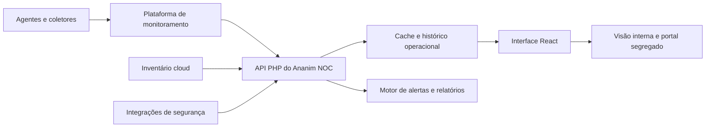

# Arquitetura — Ananim NOC

Diagrama lógico, sem endereços, credenciais ou topologia de clientes.

## Da coleta à investigação

As fontes fornecem métricas, eventos Windows, sinais de serviços e processos, inventário de contas AD e observações de sessões. O portal associa essas informações ao cliente, ao host e ao período consultado.

O fluxo de correlação organiza episódios temporais, recorrências e contexto do papel do servidor. A interface permite comparar os sinais técnicos com o histórico de usuários e sessões. Isso oferece uma visão do impacto percebido, mantendo separadas a observação, a hipótese e a confirmação de causa.

Contas AD e sessões têm semânticas distintas. Totalizadores precisam tratar diretórios compartilhados e evitar duplicar contas por réplica de controlador de domínio. Dados ausentes ou antigos devem manter seu contexto de atualização e coleta.

## Decisões de engenharia

### Disponibilidade baseada em contexto

A janela esperada considera agenda e evidência de funcionamento; falta de resposta do agente não é automaticamente prova de queda do servidor.

### Fechamentos e registros persistentes

Históricos e ledgers preservam observações entre coletas. Reprocessamentos precisam manter rastreabilidade.

### Correlação explicável

O operador precisa enxergar eventos e horários que sustentam uma hipótese, em vez de receber uma causa apresentada como certeza sem evidência.

### Separação por cliente

O escopo de dados precisa ser validado no backend, além dos filtros de interface.

## Validação e operação

A validação de mudanças deve distinguir sintaxe/build, testes isolados, publicação e comportamento real. Um processo iniciado, uma resposta HTTP ou um botão habilitado não comprovam, isoladamente, o resultado esperado. Os detalhes operacionais, credenciais e registros de clientes ficam fora deste repositório.

## Fronteiras de responsabilidade

- A visibilidade depende de coletores ativos, permissões e retenção das fontes.
- Logs de sessão não demonstram quais arquivos foram abertos ou quais operações ocorreram no ERP.
- Correlação temporal ajuda a investigar, mas não substitui análise de causa raiz.
- O snapshot de código não contém dados de clientes, ledgers, contas ou segredos do ambiente.
