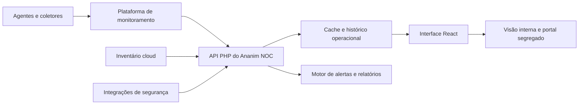

# Ananim NOC

**Observabilidade • Correlação • Usuários • Segurança • Operações**  
Contexto operacional para agir com evidência.

Portal de operação que conecta infraestrutura, aplicações e experiência dos usuários. Reúne disponibilidade, métricas, serviços, processos, eventos, sessões, Active Directory e saúde SAP/HANA em uma visão por cliente e servidor. Permite investigar quem estava conectado, em qual host, o que ocorreu naquele período e quais sinais técnicos podem explicar o impacto observado.

> **Portfólio público de Gustavo Souza.** Este repositório apresenta o projeto; não contém o código operacional, acesso a ambientes ou dados de clientes. A imagem é uma composição demonstrativa baseada nas funcionalidades descritas, não uma captura da produção. Números e entidades são fictícios.

## O problema que o projeto resolve

Uma lista de alarmes não explica, sozinha, o impacto no cliente. Manutenção programada, horários de funcionamento, indisponibilidade de coleta e falhas reais precisam ser distinguidos para reduzir interpretações erradas e orientar a operação.

## O que faz hoje

A relação abaixo foi preparada a partir dos módulos e registros técnicos do projeto. Não representa uma nova auditoria de produção ou promessa de cobertura universal.

| Área | Capacidade implementada | Aplicação prática |
|---|---|---|
| Dashboard operacional | Visão de clientes, servidores, serviços e incidentes com detalhamento. | Sair da visão geral e chegar ao servidor e ao serviço que precisam de atenção. |
| Disponibilidade contextual | Cálculo com janelas esperadas de operação, agendas e evidências de telemetria. | Evitar tratar uma máquina programada para ficar desligada como indisponibilidade equivalente a uma falha em produção. |
| Correlação | Agrupamento temporal e contexto de eventos, recursos e sintomas. | Investigar relações entre quedas de serviços, memória, paginação e sessões; correlação não é prova automática de causa. |
| SAP e HANA | Painéis de saúde, serviços, recursos e informações de coletores quando disponíveis. | Acompanhar sinais operacionais de aplicações empresariais e apoiar diagnóstico. |
| Segurança e sessões | Visões de eventos Windows, contas, sessões remotas e integração com proteção de endpoints. | Separar login aceito, tentativa rejeitada e alteração administrativa, respeitando o limite da coleta. |
| Alertas e comunicação | Regras, deduplicação, persistência, recuperação e relatórios por cliente. | Reduzir repetição de alertas e produzir comunicação com contexto. |
| Portal por cliente | Visões segregadas, perfis de acesso e MFA. | Oferecer acompanhamento sem expor o ambiente de outros clientes. |

## Correlação: entender a sequência e o impacto

O painel reúne alertas, logs e métricas na mesma janela de investigação. Em vez de analisar cada sintoma isoladamente, o operador acompanha a sequência dos eventos e suas possíveis relações:

- **Episódios por servidor:** agrupa eventos próximos no tempo; um reboot seguido por várias quedas de serviço pode ser analisado como um episódio.
- **Recorrência:** destaca alertas que se repetem, sua distribuição temporal e cadência para investigar problemas crônicos.
- **Diagnóstico por papel:** considera se o servidor atende SAP, HANA, SQL, Active Directory ou sessões RDS ao apresentar hipóteses e caminhos de verificação.
- **Impacto nos usuários:** compara a evolução de usuários e sessões com alertas, CPU, memória, paginação e reinícios de serviços.
- **Operação esperada:** considera padrões de liga/desliga e reinícios programados para distinguir rotina operacional de eventos inesperados.
- **Evidências:** mantém o contexto de horários, logs e métricas que sustentam a investigação. A hipótese indicada precisa ser confirmada; proximidade temporal não comprova causa.

## Visão de usuários, Active Directory e sessões

| Pergunta operacional | Visão oferecida |
|---|---|
| Quem está conectado e onde? | Detalhamento por cliente, servidor de sessão e usuário, conforme a última coleta disponível. |
| Quantos usuários utilizam os servidores de sessão SAP? | Contagens e histórico por host, com comparação temporal aos alertas. Sessão no host e processo do cliente SAP são sinais distintos de uso. |
| Quantas contas existem e quantas são utilizadas? | Comparação entre contas cadastradas/habilitadas no AD, usuários observados em sessões no período de 90 dias e conectados na última coleta. |
| Houve desconexões durante um incidente? | Eventos e histórico de sessões para comparar quedas de conexão com pressão de recursos ou reinício de serviço. |
| O que os logs mostram sobre uma conta? | Consulta contextual de eventos por usuário, cliente, host e período, dentro das fontes e da retenção disponíveis. |
| Como analisar diretórios compartilhados? | Organização por cliente e deduplicação nos totalizadores para reduzir dupla contagem de réplicas do mesmo diretório. |

O painel distingue **conta habilitada**, **usuário observado no histórico** e **sessão conectada**. Esses indicadores respondem perguntas diferentes. Uma sessão RDP não comprova, sozinha, uma operação dentro do SAP ou acesso a determinado arquivo.

## Segurança e investigação de eventos

As visões de segurança utilizam eventos Windows coletados, incluindo falhas de logon, bloqueios de conta, limpeza do log de auditoria e alterações de contas ou grupos administrativos. Rajadas de falhas podem ser destacadas para investigação, mas não demonstram, sozinhas, invasão ou intenção maliciosa.

Logs de Application e System ajudam a contextualizar falhas de aplicação e serviço. Integrações de proteção de endpoints complementam essa análise quando configuradas. A investigação deve separar tentativa rejeitada, autenticação aceita e ação administrativa efetivamente registrada.

## Mais recursos operacionais

- **SAP/HANA:** saúde de serviços e recursos, informações de coletores e contexto para investigação de aplicações empresariais.
- **Processos e discos:** consulta de consumo e capacidade para investigar pressão de recursos e apoiar planejamento.
- **Inventário e topologia:** contexto dos servidores e relações do ambiente para orientar a navegação técnica.
- **VPN, DNS e backups:** módulos de acompanhamento conforme as integrações e fontes configuradas.
- **Disponibilidade:** agenda operacional, telemetria e histórico persistente para produzir indicadores com contexto.
- **Relatórios e exportações:** consolidação de informações por cliente para operação, gestão e investigações autorizadas.
- **Alertas correlacionados:** comunicação com contexto de incidente, deduplicação e recuperação, conforme configuração.
- **Portal segregado e MFA:** acompanhamento por cliente com controle de escopo e acesso.

## Como funciona

**Stack:** React · TypeScript · Vite · PHP · APIs de monitoramento · MySQL para histórico · PowerShell · Linux/Windows · Integrações cloud.

Veja as decisões e os limites da arquitetura em [ARCHITECTURE.md](ARCHITECTURE.md).

## Exemplo de uso

Usuários relatam desconexões do SAP. A equipe seleciona o cliente e o período, identifica os servidores de sessão e compara a queda de usuários conectados com memória, paginação, reinícios de serviços e eventos Windows. Em seguida, verifica se houve reboot programado, agrupa os sintomas do mesmo episódio e registra a hipótese com as evidências encontradas. O relatório diferencia o impacto observado da causa ainda em validação.

## Competências demonstradas

- Traduzir necessidades operacionais em uma aplicação utilizável.
- Integrar fontes de dados e preservar o significado de cada informação.
- Projetar controles de acesso, rastreabilidade e limites operacionais.
- Construir interfaces que apoiam diagnóstico e decisão.
- Documentar trade-offs, validação e caminhos de evolução.

## O que pode evoluir

As propostas de [ROADMAP.md](ROADMAP.md) estão separadas dos recursos existentes. Elas não são apresentadas como funcionalidades já entregues.

## Limites importantes

- A visibilidade depende de coletores ativos, permissões e retenção das fontes.
- Logs de sessão não demonstram quais arquivos foram abertos ou quais operações ocorreram no ERP.
- Correlação temporal ajuda a investigar, mas não substitui análise de causa raiz.
- O snapshot de código não contém dados de clientes, ledgers, contas ou segredos do ambiente.

## Sobre as imagens e o código

As telas deste repositório usam somente conteúdo fictício e ilustram a proposta funcional. A aparência da produção pode diferir. Não há dados operacionais embutidos, links de acesso aos ambientes ou demonstração conectada a sistemas reais.

O código-fonte é mantido em repositório privado. Não existe autorização de uso ou distribuição do sistema operacional por meio deste repositório. Marcas e componentes de terceiros permanecem sujeitos aos direitos e licenças correspondentes.

## English overview

An operations portal that brings together availability, telemetry, services, inventory, enterprise application health and security context. It demonstrates operational reasoning, tenant isolation and evidence-based incident investigation. Visibility remains limited by the collected sources and their retention.

## Projetos relacionados

- [AnanimCloudReport](https://github.com/gsouzacloud/ananim-cloud-report-portfolio)
- [Ananim NOC](https://github.com/gsouzacloud/ananim-noc-portfolio)
- [Ananim Shield](https://github.com/gsouzacloud/ananim-application-shield-portfolio)

[Perfil de Gustavo Souza](https://github.com/gsouzacloud) · Documentação preparada em 18/11/2026.
