# NOC Operation Center

**Observability · Correlation · Users · Security · Operations**

[English](README.md) · [Português](README.pt-BR.md)

An operations portal that connects infrastructure, applications and user experience. It brings together availability, metrics, services, processes, logs, sessions, Active Directory, SAP/HANA health, EDR, cloud audit, VPN and backups in one view per client and per server — so the team can answer *who was connected, on which host, what happened in that period and which technical signals explain the impact*.

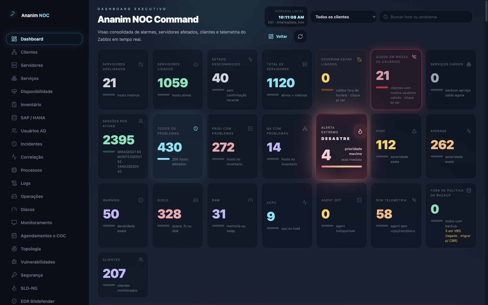

> **Portfolio of Gustavo Souza.** **About the screenshots:** they are real captures of the production interface (November 2026). Client names, hostnames, IP addresses, users, e-mails and domains were replaced automatically at capture time by fictitious ones (e.g. `CLIENTE ALFA`, `app2.exemplo.com`, `usuario.1`, `10.20.x.x`); cloud account names and the operator's brand are blurred; financial values are scrambled. Layout, features and workflows are exactly what runs in production.

## The problem

A list of alarms alone does not explain the impact on a client. Scheduled maintenance, business-hours shutdowns, collection gaps and real failures must be told apart, otherwise the team chases noise and misses what matters. NOC Operation Center adds that context: expected schedules, learned behavior, correlation and per-client scope.

## At a glance

| Area | What it delivers |
|---|---|
| **Dashboard** | Executive view of servers, problems by severity/type, services, RDS sessions and backup compliance. |
| **Availability** | SLA measured only inside each machine's expected window, scheduled time excluded, Excel export. |
| **Correlation** | Root-cause chains, chronic alerts, probable cause with evidence, duplicate-agent detection. |
| **Users & AD** | Real 90-day users vs AD accounts vs connected now; mass-disconnect detection. |
| **SAP / HANA** | Memory capacity, services up/down, database and backup health. |
| **Security** | Posture scoring, cloud audit trail, RDP brute-force protection with effectiveness proof, EDR posture. |
| **Operations** | Unified schedules, remote actions, disks, processes, logs, topology, VPN, DNS, backups. |
| **Reports** | PDF / PPTX client reports, Excel / CSV / HTML exports, correlated alert e-mails. |
| **Multi-tenant** | Segregated client portal with MFA and backend-enforced scope. |

<table><tr><td width="33%"> Executive dashboard</td><td width="33%">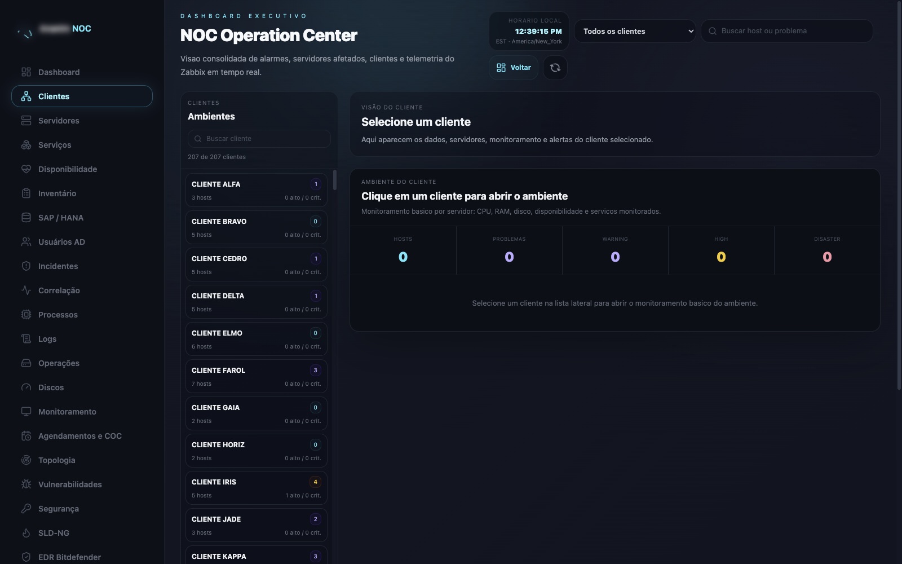 Clients (tenants)</td><td width="33%">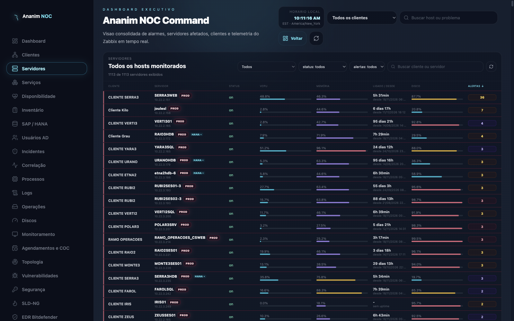 Servers</td></tr><tr><td width="33%">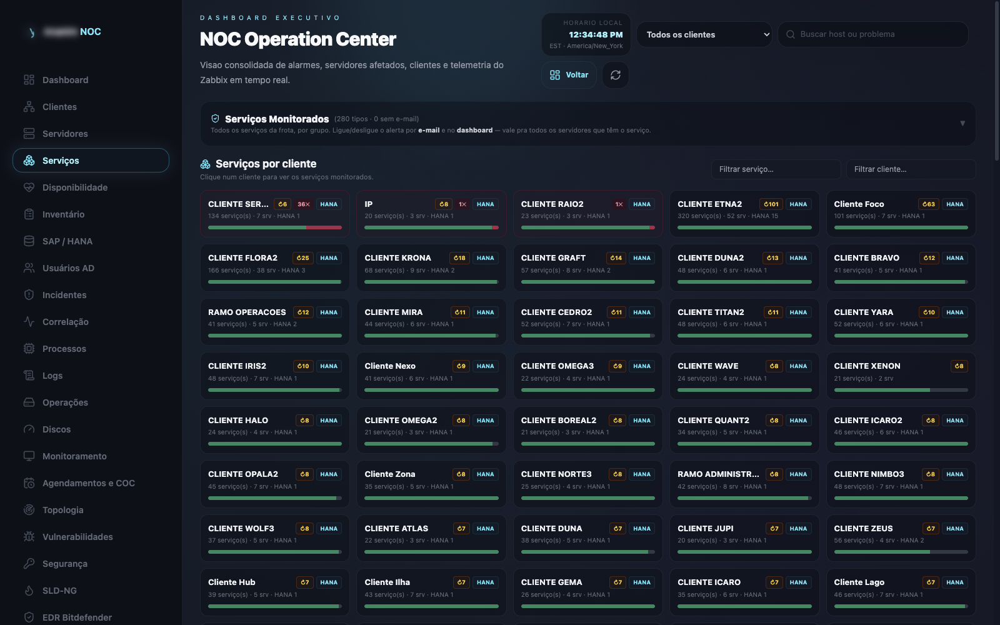 Services</td><td width="33%">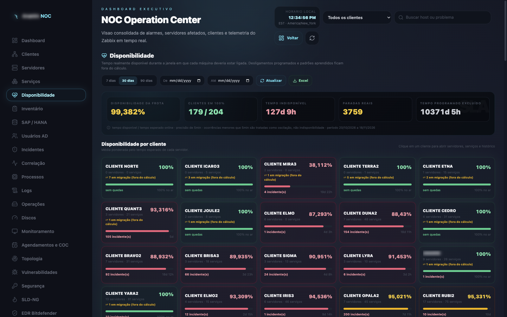 Availability (SLA)</td><td width="33%">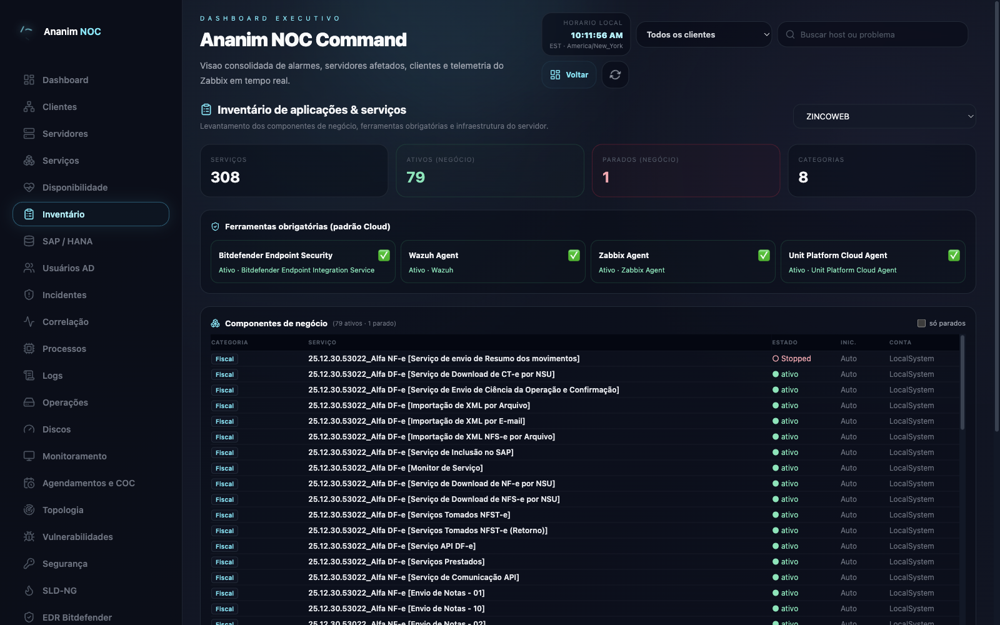 Application & service inventory</td></tr></table>

## White-label and SaaS-ready

NOC Operation Center was built to be **white-label**. Brand name, logo, colors, report letterhead, tenant list, cloud accounts and integrations are configuration — not hard-coded. The same platform can be:

- **deployed for any company** — an MSP, a cloud reseller, a managed-services provider or an internal IT team;
- **run single-tenant** (one company, on its own infrastructure) or **multi-tenant**, with every tenant isolated by scope validated in the backend;
- **offered as a SaaS**, with per-tenant onboarding, role-based access and MFA already part of the design.

Nothing in the NOC is tied to one client: tenants are discovered from monitoring groups and cloud projects, and each client can get its own segregated portal login (with MFA) showing only its own servers, availability and reports.

Adapting it to a new company means configuring branding, connectors and credentials for that environment and validating them with its own data.

## Screen-by-screen tour

### 1. Executive dashboard

- Fleet status at a glance: servers on, off and in unknown state, plus total.
- "Should be on": machines down **outside** their expected schedule — the alarms that really matter.
- Mass user drop per client (many RDP/SAP users disconnecting at once), services down, active RDS sessions per session host.
- Problems by exact severity (Disaster / High / Average / Warning) and by type: disk, RAM, vCPU, agent off, no telemetry.
- PROD vs QA split, backup-policy compliance, filter by client, auto-refresh every 30 s.

### 2. Clients (tenants)

- One card per client environment with host count, open problems and high/critical counters.
- Click-through to the client's servers, services and history.

### 3. Servers

- Every monitored host with environment tag (PROD/QA), role badge (e.g. HANA), IP, power state, vCPU, memory, uptime ("on since"), disk and alert count.
- Filters by status (on/off/unknown) and alerts (all/with alert/critical); search by name or IP; sortable columns.
- Drill-down to the host page: telemetry charts, services, processes, logs, sessions and agent diagnostics on demand.

### 4. Services

- All Windows/Linux services in the fleet grouped by type (hundreds of types) and by client.
- Turn e-mail and dashboard alerting on/off per service type — applies to every server running it.
- "Went down and came back" counter (↻) to spot flapping services, and ✕ for services down now.
- Add or remove a service from monitoring on a specific host directly from the portal.

### 5. Availability (SLA)

- Availability computed **only inside the window each machine was expected to be on**.
- Scheduled shutdowns, learned on/off patterns and machines under migration are excluded from the calculation.
- 5-minute precision; drops shorter than 5 minutes are treated as oscillation, not downtime.
- Per-client availability weighted by expected time, with real outages, downtime and excluded scheduled time.
- 7 / 30 / 90 days or custom range; Excel export.

### 6. Application & service inventory

- Per-server inventory of business components, mandatory tools (agents, EDR, backup) and infrastructure.

### 7. SAP / HANA

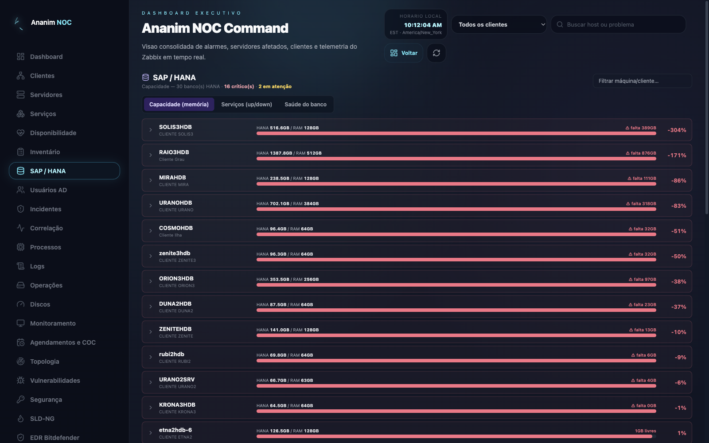

- HANA memory capacity: database allocation vs VM RAM, ranked by how much memory is missing.
- HANA services up/down (process-level detection) and database health: backups of SYSTEMDB/tenant, chunks, watchdog.
- Collectors supported both via agent items and via CSV/JSON files for hosts without direct access.

### 8. Active Directory users

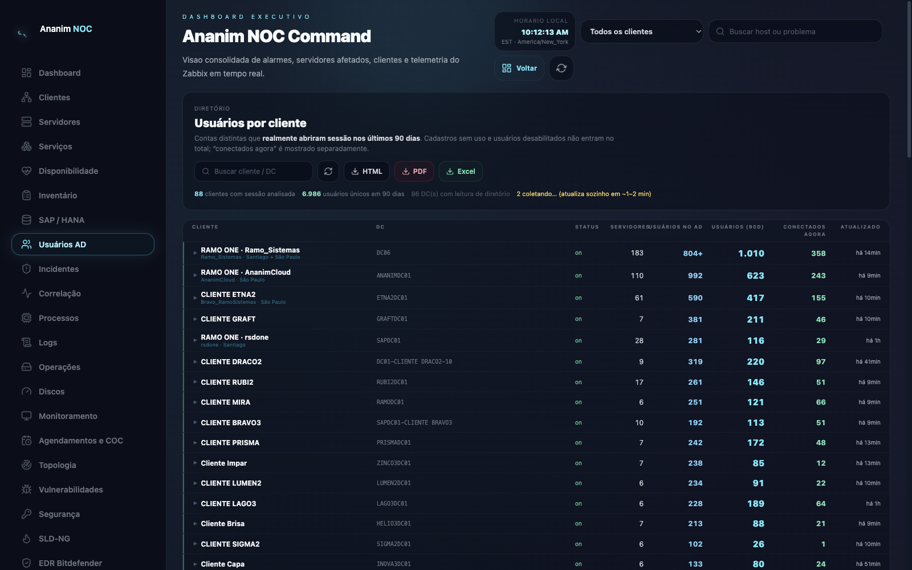

- Per domain controller / client: accounts in AD, distinct users who actually opened a session in the last 90 days, and users connected now.
- Unused and disabled accounts are kept out of the total — useful for license reviews.
- Deduplication for shared directories so replicas do not double-count.
- Export to HTML, PDF and Excel.

### 9. Incident center

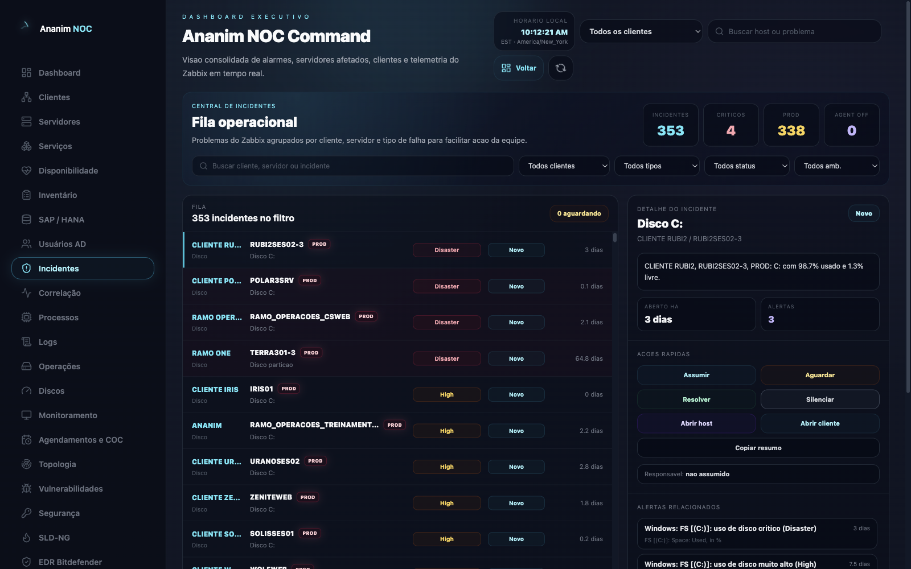

- Operational queue: monitoring problems grouped by client, server and failure type (disk, RAM, network, service, system, vCPU).
- Workflow states: New → In analysis → Waiting → Resolved / Silenced; age of each incident.
- Filters by client, type, status and environment.

### 10. Correlation & root cause

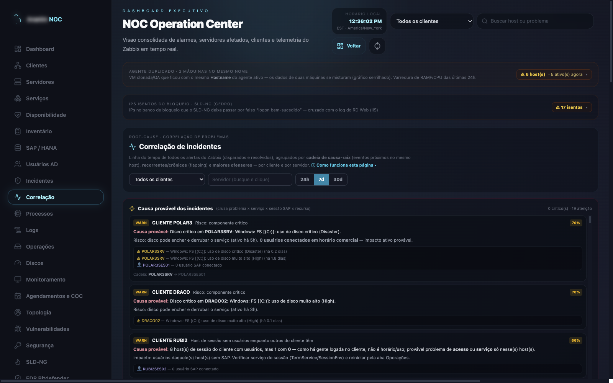

- Timeline of every alert (fired and resolved) grouped into **root-cause chains** — events close in time on the same host.
- Recurrent/chronic alerts (flapping) and top offenders by client and server.
- **Probable cause** engine crossing problem × service × SAP session × resource, with a risk score and the evidence behind it.
- Special detectors: duplicate agents (cloned VM reporting under the same hostname), RDP-protection IPs exempted by mistake (cross-checked with the RD Web log).
- 24 h / 7 d / 30 d windows. Correlation is presented as a hypothesis with evidence, never as proof.

### 11. CPU per process

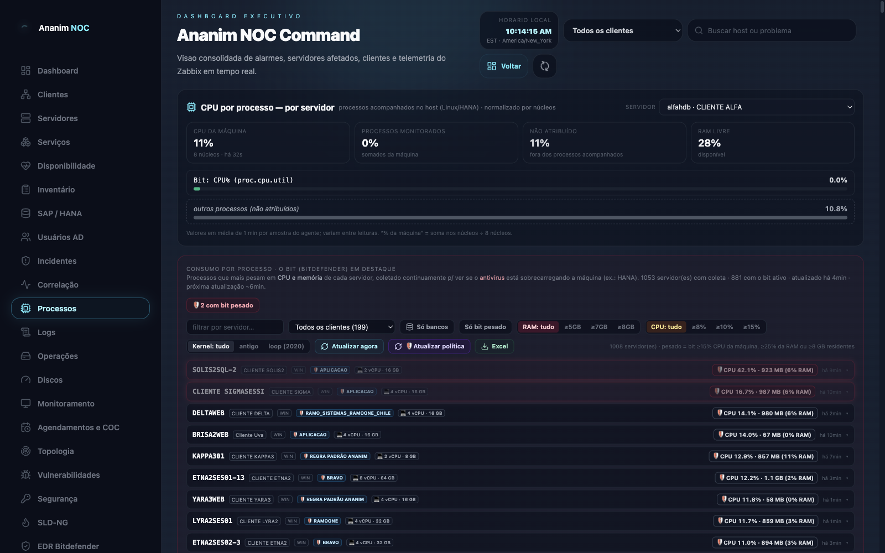

- Top processes per server, normalized by number of cores (Linux/HANA), with history.
- Windows hosts show per-process cards (e.g. EDR engine), useful to separate application load from security-agent load.

### 12. Server logs

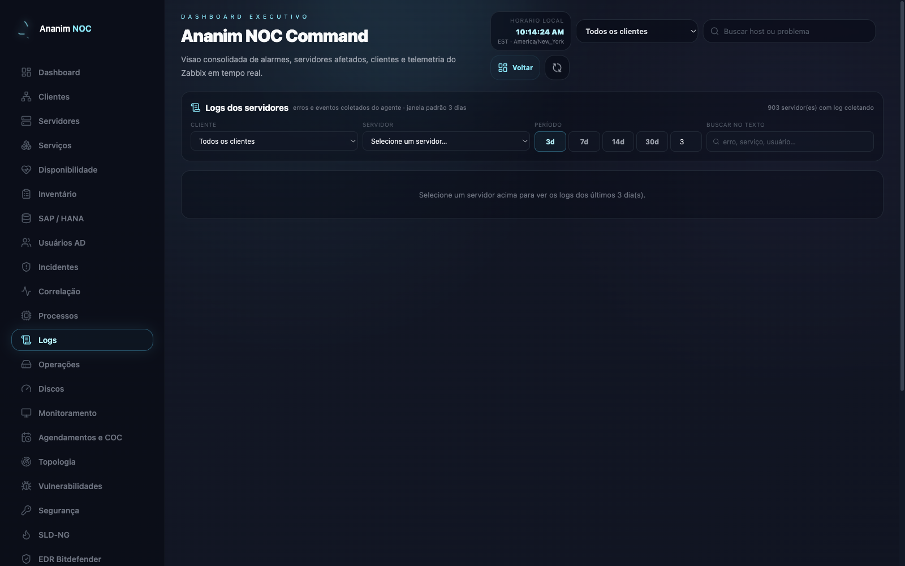

- Errors and events collected by the agent (Windows Application/System/Security, Linux logs), default 3-day window.
- Flags servers where log reading is blocked so blind spots are visible.

### 13. Remote operations

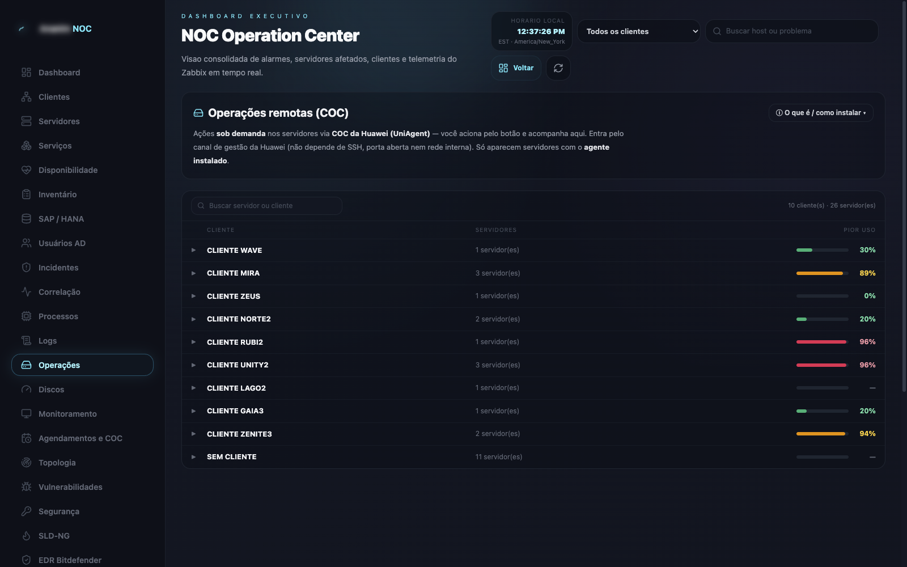

- On-demand actions on servers through the cloud provider's management agent — no SSH, open port or internal network needed.
- Grouped by client with the worst disk usage per group; results are tracked in the portal.

### 14. Disks

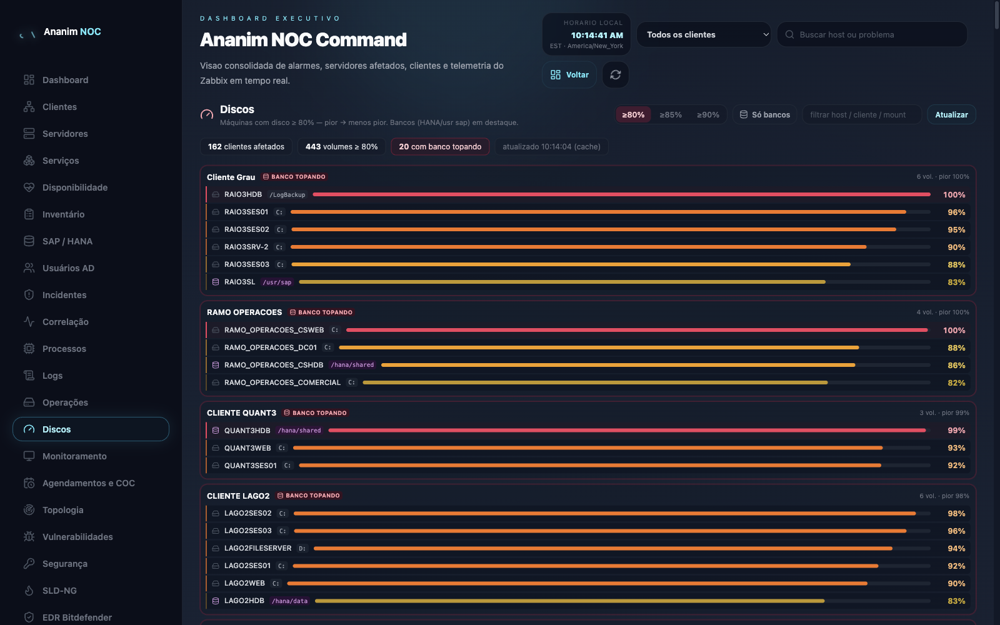

- Every volume ≥ 80 % (or 85 / 90 %), worst first, grouped by client.
- Database volumes (`/hana/data`, `/hana/shared`, `/LogBackup`, `/usr/sap`) highlighted as "database topping out".

### 15. Monitoring coverage

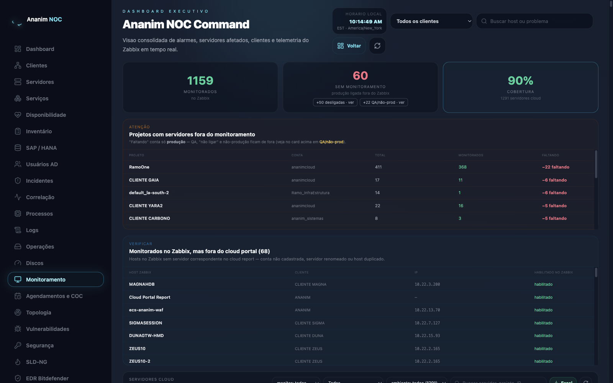

- Cloud servers × monitored hosts: coverage %, production machines running without monitoring, per project and account.
- The reverse check too: monitored hosts with no matching cloud server (ghosts and leftovers).

### 16. Unified schedules

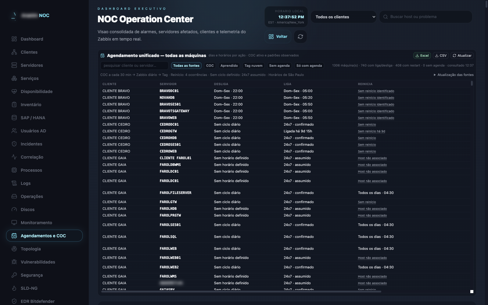

- One table with stop / start / restart days and times for every machine.
- Sources merged and labeled: cloud scheduler jobs, patterns **learned** from telemetry, and cloud tags; machines with no cycle are assumed 24×7.
- This is what feeds availability and alert suppression. Excel / CSV export.

### 17. Network topology

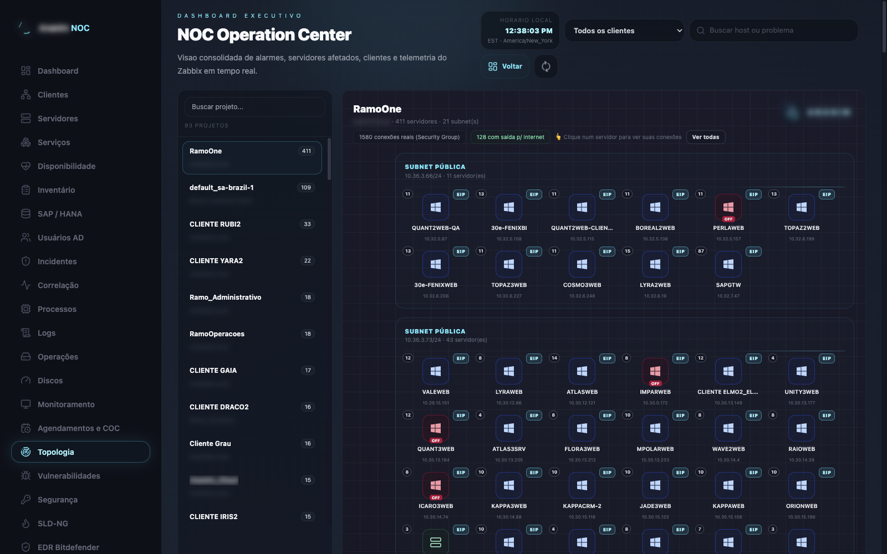

- Project → subnet → server map built from the cloud API, with public IPs and internet egress.
- Real allowed connections derived from Security Group rules; click a server to see its connections.

### 18. Security posture

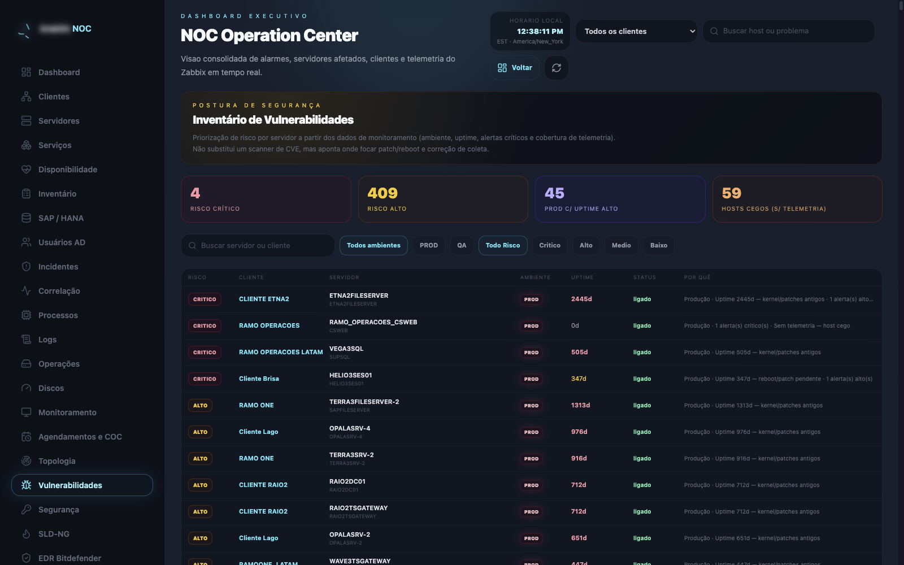

- Risk prioritization per server from monitoring data: environment, very long uptime (pending patches/reboots), critical alerts and hosts without telemetry.
- Explains *why* each server is critical/high. It is a prioritization aid, not a CVE scanner.

### 19. Cloud audit (credentials & access)

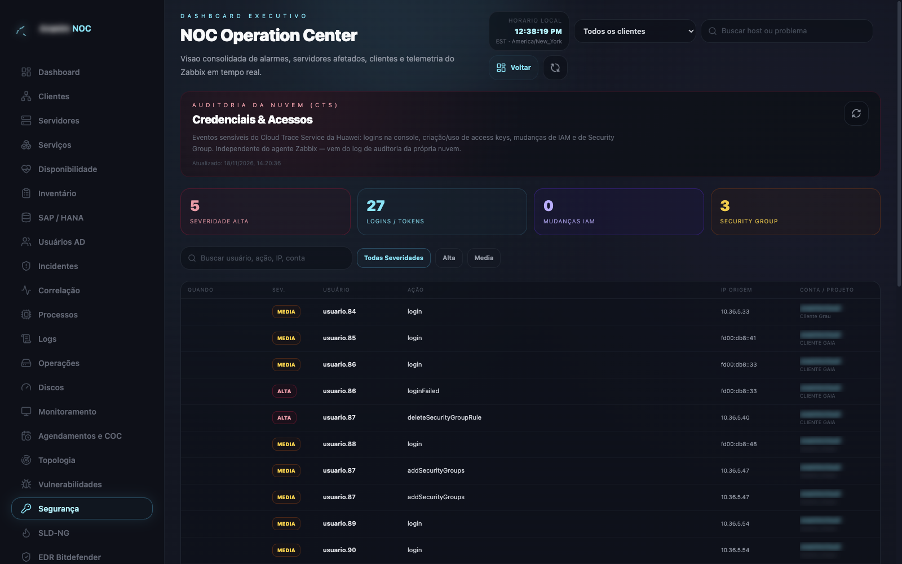

- Sensitive events from the cloud audit trail: console logins and failed logins, access keys, IAM changes and Security Group changes.
- Severity, user, action, source IP and account/project; independent of the monitoring agent.

### 20. RDP brute-force protection

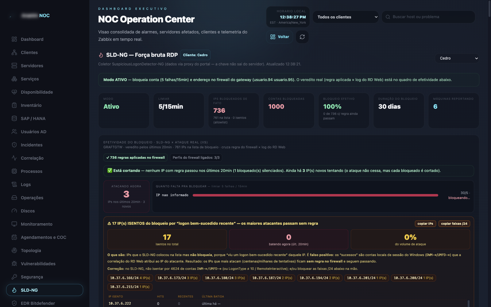

- Dashboard for an RDP brute-force detector: mode, threshold (failures per window), IPs blocked in the gateway firewall, locked accounts, block duration.
- **Effectiveness check**: firewall rules × real RD Web (IIS) log — proves whether blocked IPs are actually being cut.
- "Attacking now" and "how close to the threshold" views.

### 21. EDR posture

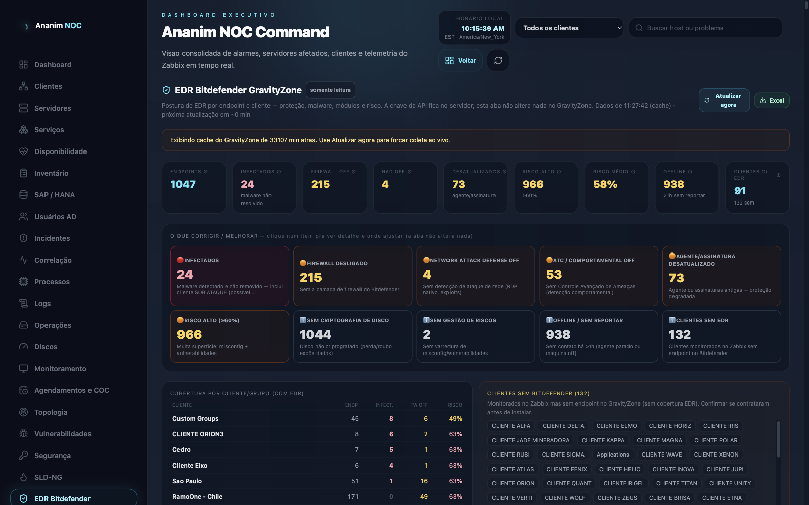

- Read-only EDR posture per endpoint and client: infected, firewall off, network-attack defense off, behavioral protection off, outdated, offline, risk score.
- "What to fix" list with where to adjust; the API key stays on the server and the tab never changes the EDR console. Excel export.

### 22. VPN

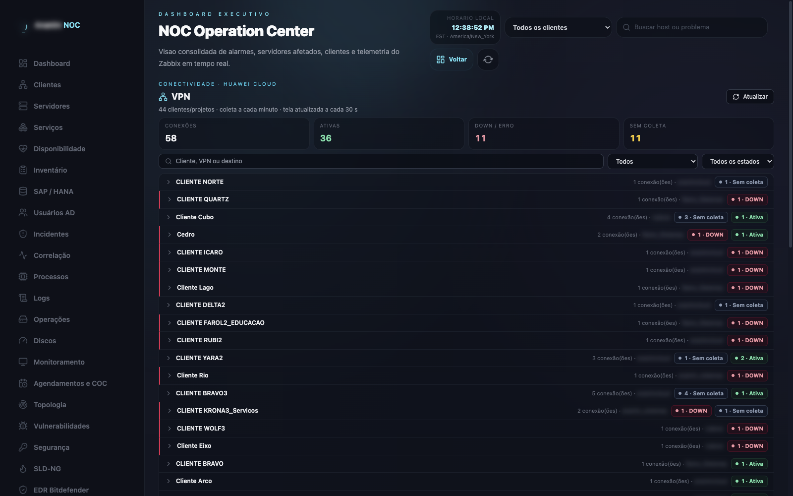

- Site-to-site VPN connections of every client/project: active, down/error, no data.
- Collected every minute, screen refreshed every 30 s; filters by client and state.

### 23. DNS manager

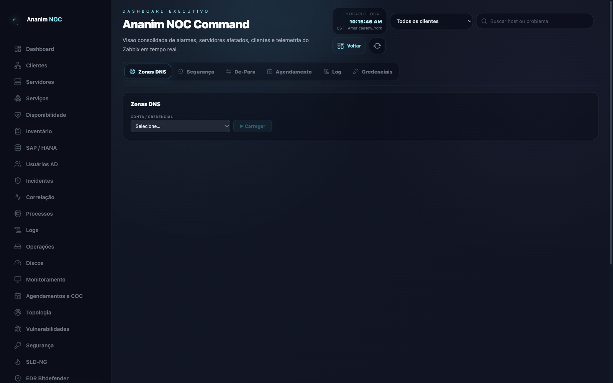

- DNS zones from external providers (e.g. Route 53), security checks, record ↔ server mapping, scheduled changes, change log and credential management.

### 24. Backup reports

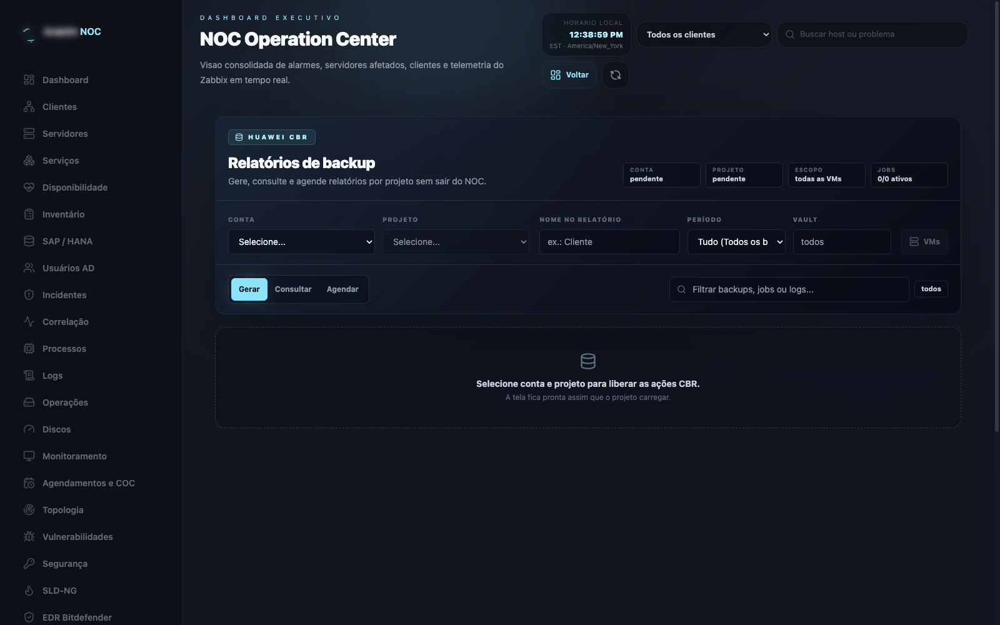

- Generate, query and **schedule** backup reports per account, project, vault and period (last day … last 90 days, current/previous month) without leaving the NOC.

### 25. Built-in documentation

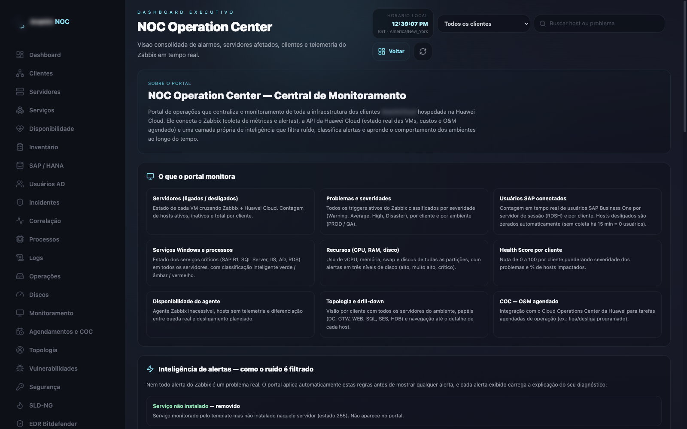

- "About the portal": what is monitored, how each indicator is calculated and its limits — written for operators and clients.

## Beyond the screens

| Capability | What it does |
|---|---|
| **Correlated alert e-mails** | Branded e-mail per incident with context (client, host, role, schedule), deduplication, reminder and recovery message. |
| **Client report (PDF / PPTX)** | Utilization report per client: availability, CPU/RAM/disk, services, backups and users — ready to present. |
| **Exports everywhere** | Excel / CSV / HTML / PDF on availability, AD users, schedules, EDR, disks and more. |
| **AI assistant** | Ask questions about the environment in natural language (operators only, never in the client portal). |
| **Segregated client portal + MFA** | Per-client users, own TOTP MFA, scope enforced in the backend so a client never sees another client's data. |
| **Learned behavior** | Learns on/off cadence and scheduled reboots per host to avoid false "down" alarms. |
| **Host reconciliation** | Detects hosts deleted in the cloud but still in monitoring and keeps the inventory clean. |
| **Global search** | Find any client, server, IP or service from anywhere in the portal. |

## Correlation: understanding sequence and impact

Alerts, logs and metrics are placed in the same investigation window. Instead of looking at each symptom alone, the operator follows the sequence:

- **Episodes per server** — a reboot followed by several service drops is analyzed as one episode.
- **Recurrence** — repeating alerts, their time distribution and cadence, to find chronic problems.
- **Role-aware diagnosis** — whether the server runs SAP, HANA, SQL, Active Directory or RDS shapes the hypotheses and checks.
- **User impact** — users and sessions over time compared with alerts, CPU, memory, paging and service restarts.
- **Expected operation** — on/off patterns and scheduled restarts separate routine from unexpected events.
- **Evidence** — timestamps, logs and metrics stay attached to the hypothesis. Temporal proximity does not prove causation.

## How it works

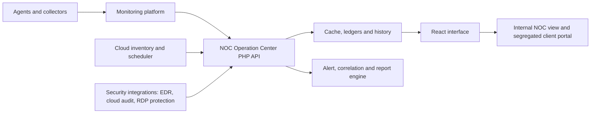

**Stack:** React · TypeScript · Vite · PHP · monitoring APIs (Zabbix) · MySQL history · PowerShell · Linux / Windows · cloud APIs (Huawei Cloud) · EDR and audit integrations.

Architecture decisions and limits: [ARCHITECTURE.md](ARCHITECTURE.md) · Evolution ideas: [ROADMAP.md](ROADMAP.md) · Screenshot notes: [VISUALS.md](VISUALS.md)

## Example

Users report SAP disconnections. The team selects the client and period, finds the session hosts, and compares the drop in connected users with memory, paging, service restarts and Windows events. It checks whether a scheduled reboot happened, groups the symptoms of the same episode and records the hypothesis with the evidence. The report separates observed impact from the cause still being validated.

## Skills demonstrated

- Turning operational needs into a usable product used daily by a NOC team.
- Integrating many data sources while preserving the meaning of each signal.
- Multi-tenant design: access control, MFA, backend scope enforcement, audit.
- Interfaces that support diagnosis and decision, not just display.
- Honest documentation of trade-offs, validation and limits.

## Important limits

- Visibility depends on active collectors, permissions and source retention.
- Session logs do not show which files were opened or which ERP operations were made.
- Temporal correlation helps investigate; it does not replace root-cause analysis.

## Source code

The source code is kept in a private repository. This repository is a portfolio: documentation and screenshots only — no operational code, credentials, access to environments or client data. Third-party trademarks and components remain subject to their own rights and licenses.

## Related projects

- [NOC Operation Center](https://github.com/gsouzacloud/noc-operation-center-portfolio) — operations, correlation, users & security
- [Cloud Report](https://github.com/gsouzacloud/cloud-report-portfolio) — cloud FinOps & governance
- [Shield](https://github.com/gsouzacloud/shield-portfolio) — WAF & application security

[Gustavo Souza on GitHub](https://github.com/gsouzacloud) · Documentation updated November 18, 2026.
