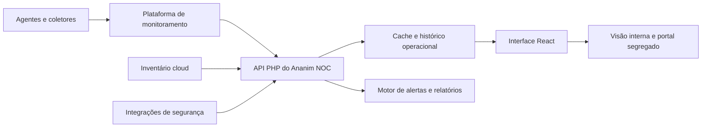

# Ananim NOC

**Observability & Operations**  
Contexto operacional para agir com evidência.

Portal de operação que reúne disponibilidade, telemetria, serviços, inventário, segurança e saúde de aplicações em uma visão por cliente e servidor. Foi concebido para aproximar o alerta técnico do contexto necessário para investigar e comunicar um incidente.

> **Portfólio público de Gustavo Souza.** Este repositório apresenta o projeto; não contém o código operacional, acesso a ambientes ou dados de clientes. A imagem é uma composição demonstrativa baseada nas funcionalidades descritas, não uma captura da produção. Números e entidades são fictícios.

## O problema que o projeto resolve

Uma lista de alarmes não explica, sozinha, o impacto no cliente. Manutenção programada, horários de funcionamento, indisponibilidade de coleta e falhas reais precisam ser distinguidos para reduzir interpretações erradas e orientar a operação.

## O que faz hoje

A relação abaixo foi preparada a partir dos módulos e registros técnicos do projeto. Não representa uma nova auditoria de produção ou promessa de cobertura universal.

| Área | Capacidade implementada | Aplicação prática |
|---|---|---|
| Dashboard operacional | Visão de clientes, servidores, serviços e incidentes com detalhamento. | Sair da visão geral e chegar ao servidor e ao serviço que precisam de atenção. |
| Disponibilidade contextual | Cálculo com janelas esperadas de operação, agendas e evidências de telemetria. | Evitar tratar uma máquina programada para ficar desligada como indisponibilidade equivalente a uma falha em produção. |
| Correlação | Agrupamento temporal e contexto de eventos, recursos e sintomas. | Investigar relações entre quedas de serviços, memória, paginação e sessões; correlação não é prova automática de causa. |
| SAP e HANA | Painéis de saúde, serviços, recursos e informações de coletores quando disponíveis. | Acompanhar sinais operacionais de aplicações empresariais e apoiar diagnóstico. |
| Segurança e sessões | Visões de eventos Windows, contas, sessões remotas e integração com proteção de endpoints. | Separar login aceito, tentativa rejeitada e alteração administrativa, respeitando o limite da coleta. |
| Alertas e comunicação | Regras, deduplicação, persistência, recuperação e relatórios por cliente. | Reduzir repetição de alertas e produzir comunicação com contexto. |
| Portal por cliente | Visões segregadas, perfis de acesso e MFA. | Oferecer acompanhamento sem expor o ambiente de outros clientes. |

## Como funciona

**Stack:** React · TypeScript · Vite · PHP · APIs de monitoramento · MySQL para histórico · PowerShell · Linux/Windows · Integrações cloud.

Veja as decisões e os limites da arquitetura em [ARCHITECTURE.md](ARCHITECTURE.md).

## Exemplo de uso

Uma equipe recebe um alerta de serviço. Pelo portal, identifica cliente e servidor, verifica se o recurso deveria estar ativo, compara telemetria e eventos e registra uma hipótese sustentada por evidências. A comunicação informa o que foi observado e o que ainda precisa ser confirmado.

## Competências demonstradas

- Traduzir necessidades operacionais em uma aplicação utilizável.
- Integrar fontes de dados e preservar o significado de cada informação.
- Projetar controles de acesso, rastreabilidade e limites operacionais.
- Construir interfaces que apoiam diagnóstico e decisão.
- Documentar trade-offs, validação e caminhos de evolução.

## O que pode evoluir

As propostas de [ROADMAP.md](ROADMAP.md) estão separadas dos recursos existentes. Elas não são apresentadas como funcionalidades já entregues.

## Limites importantes

- A visibilidade depende de coletores ativos, permissões e retenção das fontes.
- Logs de sessão não demonstram quais arquivos foram abertos ou quais operações ocorreram no ERP.
- Correlação temporal ajuda a investigar, mas não substitui análise de causa raiz.
- O snapshot de código não contém dados de clientes, ledgers, contas ou segredos do ambiente.

## Sobre as imagens e o código

As telas deste repositório usam somente conteúdo fictício e ilustram a proposta funcional. A aparência da produção pode diferir. Não há dados operacionais embutidos, links de acesso aos ambientes ou demonstração conectada a sistemas reais.

O código-fonte é mantido em repositório privado. Não existe autorização de uso ou distribuição do sistema operacional por meio deste repositório. Marcas e componentes de terceiros permanecem sujeitos aos direitos e licenças correspondentes.

## English overview

An operations portal that brings together availability, telemetry, services, inventory, enterprise application health and security context. It demonstrates operational reasoning, tenant isolation and evidence-based incident investigation. Visibility remains limited by the collected sources and their retention.

## Projetos relacionados

- [AnanimCloudReport](https://github.com/gsouzacloud/ananim-cloud-report-portfolio)
- [Ananim NOC](https://github.com/gsouzacloud/ananim-noc-portfolio)
- [Ananim Shield](https://github.com/gsouzacloud/ananim-application-shield-portfolio)

[Perfil de Gustavo Souza](https://github.com/gsouzacloud) · Documentação preparada em 18/11/2026.
