# Ananim NOC

**Observabilidade · Correlação · Usuários · Segurança · Operações**

[English](README.md) · [Português](README.pt-BR.md)

Portal de operação que conecta infraestrutura, aplicações e experiência dos usuários. Reúne disponibilidade, métricas, serviços, processos, logs, sessões, Active Directory, saúde SAP/HANA, EDR, auditoria da nuvem, VPN e backups em uma visão por cliente e por servidor — para a equipe responder *quem estava conectado, em qual host, o que aconteceu naquele período e quais sinais técnicos explicam o impacto*.

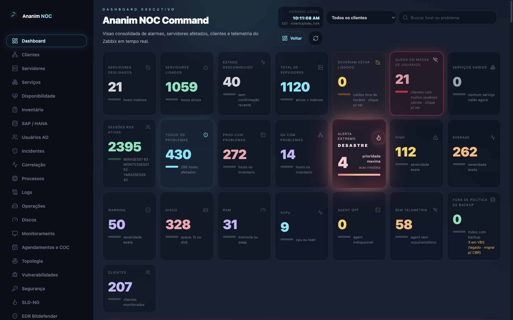

> **Portfólio de Gustavo Souza.** **Sobre as imagens:** são capturas reais da interface em produção (novembro/2026). Nomes de clientes, hostnames, IPs, usuários, e-mails e domínios foram substituídos automaticamente no momento da captura por nomes fictícios (ex.: `CLIENTE ALFA`, `app2.exemplo.com`, `usuario.1`, `10.20.x.x`); valores financeiros estão embaralhados. Layout, funcionalidades e fluxos são exatamente os que rodam em produção.

## O problema

Uma lista de alarmes, sozinha, não explica o impacto no cliente. Manutenção programada, desligamento fora do horário comercial, falha de coleta e falha real precisam ser separados; senão a equipe corre atrás de ruído e perde o que importa. O Ananim NOC adiciona esse contexto: agendas esperadas, comportamento aprendido, correlação e escopo por cliente.

## Resumo

| Área | O que entrega |
|---|---|
| **Dashboard** | Visão executiva de servidores, problemas por severidade/tipo, serviços, sessões RDS e conformidade de backup. |
| **Disponibilidade** | SLA medido só dentro da janela esperada de cada máquina, tempo programado excluído, exportação Excel. |
| **Correlação** | Cadeias de causa-raiz, alertas crônicos, causa provável com evidência, detecção de agente duplicado. |
| **Usuários e AD** | Usuários reais em 90 dias × contas no AD × conectados agora; detecção de queda em massa. |
| **SAP / HANA** | Capacidade de memória, serviços up/down, saúde do banco e dos backups. |
| **Segurança** | Priorização de risco, trilha de auditoria da nuvem, proteção contra força bruta RDP com prova de efetividade, postura de EDR. |
| **Operação** | Agenda unificada, ações remotas, discos, processos, logs, topologia, VPN, DNS, backups. |
| **Relatórios** | Relatórios PDF / PPTX por cliente, exportações Excel / CSV / HTML, e-mails de alerta correlacionados. |
| **Multi-tenant** | Portal segregado por cliente com MFA e escopo validado no backend. |

<table><tr><td width="33%"> Dashboard executivo</td><td width="33%">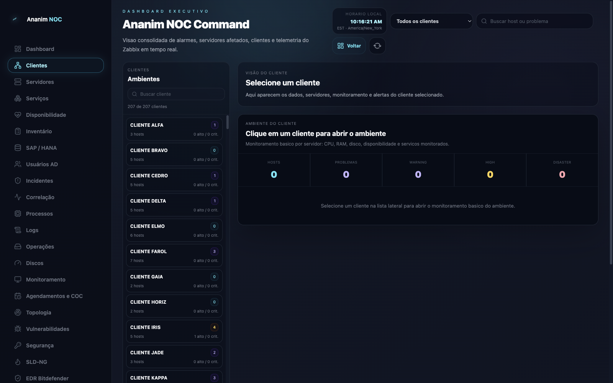 Clientes</td><td width="33%">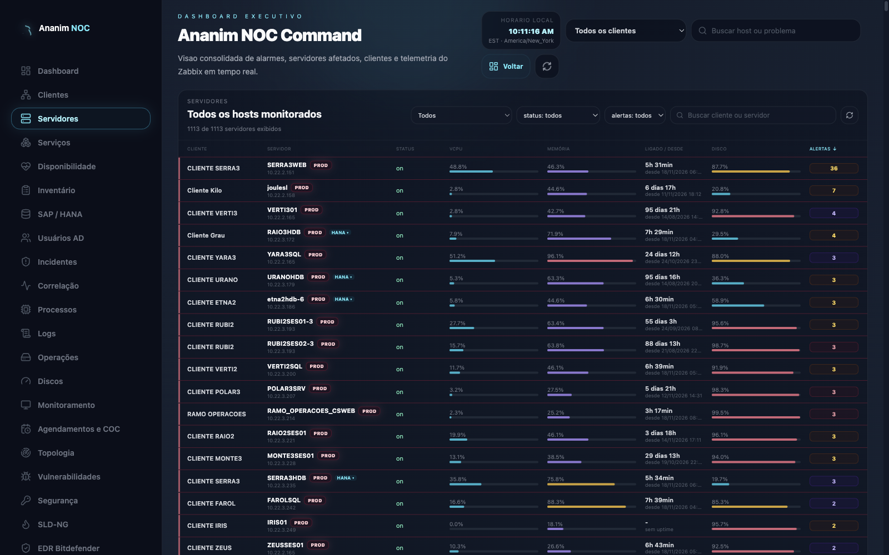 Servidores</td></tr><tr><td width="33%">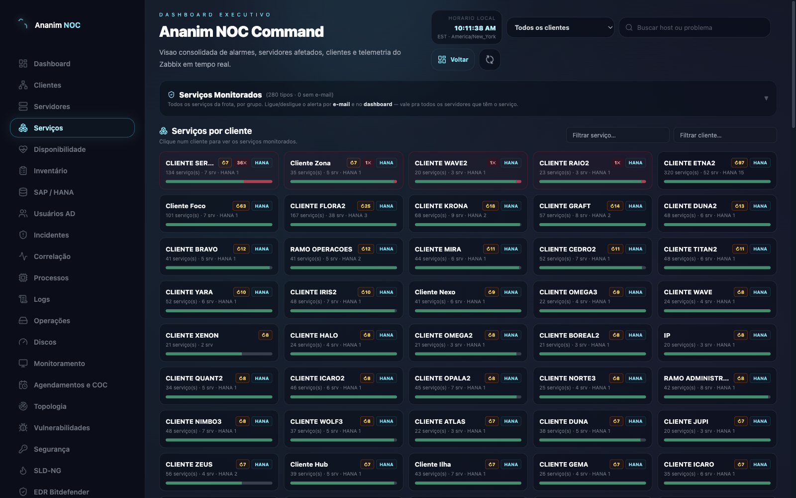 Serviços</td><td width="33%">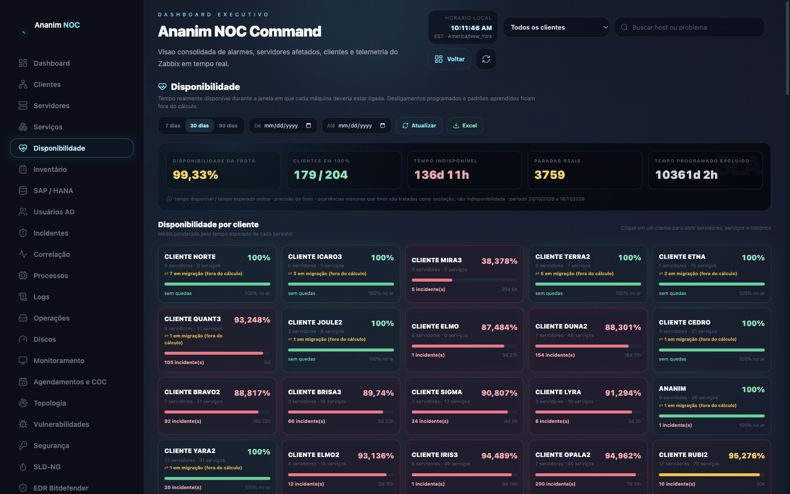 Disponibilidade (SLA)</td><td width="33%">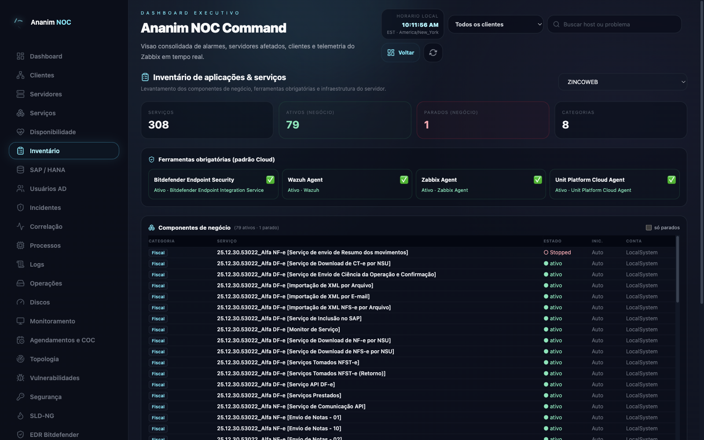 Inventário de aplicações e serviços</td></tr></table>

## White-label e pronto para SaaS

O Ananim NOC foi construído para ser **white-label**. Nome, logo, cores, papel timbrado dos relatórios, lista de clientes, contas cloud e integrações são configuração — não estão fixos no código. A mesma plataforma pode ser:

- **implantada para qualquer empresa** — MSP, revenda de cloud, provedor de serviços gerenciados ou time interno de TI;
- **operada como single-tenant** (uma empresa, na própria infraestrutura) ou **multi-tenant**, com cada cliente isolado por escopo validado no backend;
- **oferecida como SaaS**, com onboarding por cliente, perfis de acesso e MFA já previstos no desenho.

Nada no NOC é preso a um cliente: os clientes são descobertos pelos grupos do monitoramento e pelos projetos cloud, e cada cliente pode receber um login próprio no portal segregado (com MFA), vendo apenas os próprios servidores, disponibilidade e relatórios.

Adaptar para uma nova empresa significa configurar marca, conectores e credenciais daquele ambiente e validar com os dados dela.

## Tour tela a tela

### 1. Dashboard executivo

- Situação da frota de uma vez: servidores ligados, desligados, em estado desconhecido e total.
- "Deveriam estar ligados": máquinas caídas **fora** da agenda esperada — os alarmes que realmente importam.
- Queda em massa de usuários por cliente (muitos usuários RDP/SAP desconectando juntos), serviços caídos, sessões RDS ativas por servidor de sessão.
- Problemas por severidade exata (Disaster / High / Average / Warning) e por tipo: disco, RAM, vCPU, agente off, sem telemetria.
- Separação PROD × QA, conformidade com a política de backup, filtro por cliente, atualização automática a cada 30 s.

### 2. Clientes

- Um cartão por ambiente de cliente com quantidade de hosts, problemas abertos e contadores alto/crítico.
- Clique para abrir servidores, serviços e histórico do cliente.

### 3. Servidores

- Todos os hosts monitorados com ambiente (PROD/QA), papel (ex.: HANA), IP, estado, vCPU, memória, tempo ligado ("desde"), disco e quantidade de alertas.
- Filtros por status (ligado/desligado/desconhecido) e alertas (todos/com alerta/críticos); busca por nome ou IP; colunas ordenáveis.
- Página do host: gráficos de telemetria, serviços, processos, logs, sessões e diagnóstico do agente sob demanda.

### 4. Serviços

- Todos os serviços Windows/Linux da frota, agrupados por tipo (centenas de tipos) e por cliente.
- Liga/desliga o alerta por e-mail e no dashboard por tipo de serviço — vale para todos os servidores que o têm.
- Contador "caiu e voltou" (↻) para achar serviços instáveis, e ✕ para os caídos agora.
- Adicionar ou remover um serviço do monitoramento em um host específico direto pelo portal.

### 5. Disponibilidade (SLA)

- Disponibilidade calculada **apenas dentro da janela em que cada máquina deveria estar ligada**.
- Desligamentos programados, padrões aprendidos de liga/desliga e máquinas em migração ficam fora do cálculo.
- Precisão de 5 minutos; quedas menores que 5 minutos são tratadas como oscilação, não indisponibilidade.
- Disponibilidade por cliente ponderada pelo tempo esperado, com paradas reais, tempo indisponível e tempo programado excluído.
- 7 / 30 / 90 dias ou período livre; exportação Excel.

### 6. Inventário de aplicações e serviços

- Inventário por servidor dos componentes de negócio, ferramentas obrigatórias (agentes, EDR, backup) e infraestrutura.

### 7. SAP / HANA

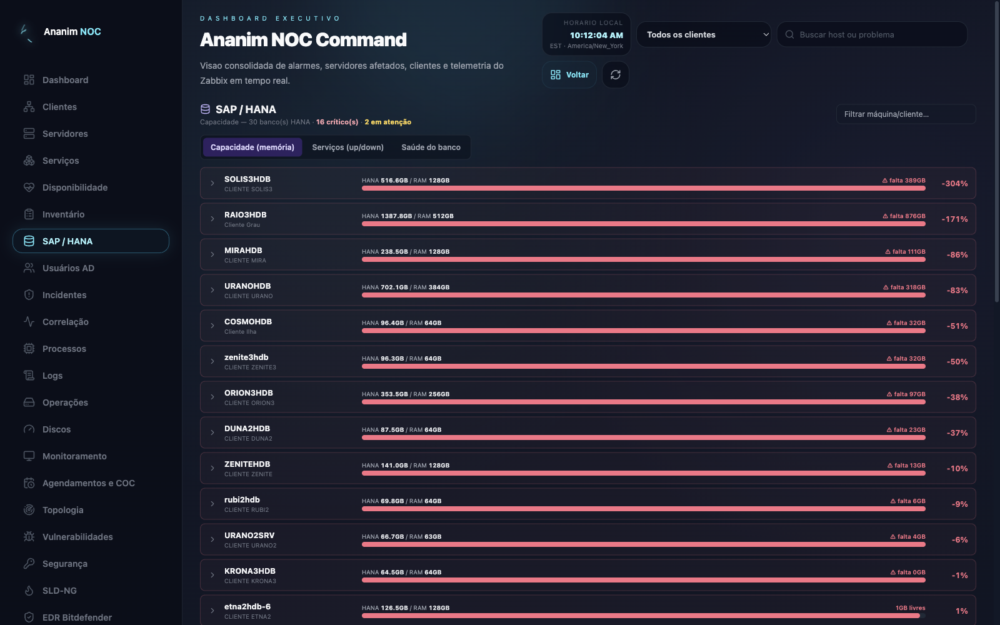

- Capacidade de memória HANA: alocação do banco × RAM da VM, ordenado pelo quanto falta de memória.
- Serviços HANA up/down (detecção por processo) e saúde do banco: backups SYSTEMDB/tenant, chunks, watchdog.
- Coletores via itens do agente e via arquivos CSV/JSON para hosts sem acesso direto.

### 8. Usuários do Active Directory

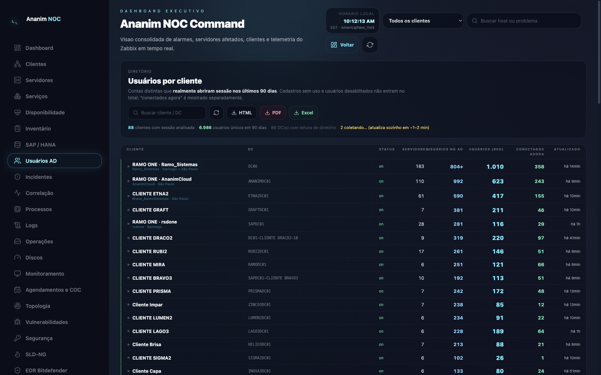

- Por controlador de domínio / cliente: contas no AD, usuários distintos que realmente abriram sessão nos últimos 90 dias e conectados agora.
- Contas sem uso e desabilitadas ficam fora do total — útil para revisão de licenças.
- Deduplicação para diretórios compartilhados, evitando contar réplicas duas vezes.
- Exportação em HTML, PDF e Excel.

### 9. Central de incidentes

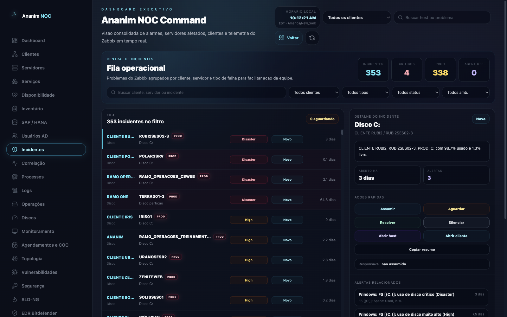

- Fila operacional: problemas do monitoramento agrupados por cliente, servidor e tipo de falha (disco, RAM, rede, serviço, sistema, vCPU).
- Fluxo: Novo → Em análise → Aguardando → Resolvido / Silenciado; idade de cada incidente.
- Filtros por cliente, tipo, status e ambiente.

### 10. Correlação e causa-raiz

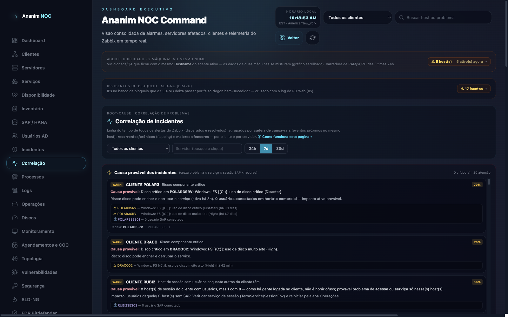

- Linha do tempo de todos os alertas (disparados e resolvidos) agrupados em **cadeias de causa-raiz** — eventos próximos no mesmo host.
- Alertas recorrentes/crônicos (flapping) e maiores ofensores por cliente e servidor.
- Motor de **causa provável** cruzando problema × serviço × sessão SAP × recurso, com nota de risco e as evidências.
- Detectores especiais: agente duplicado (VM clonada reportando com o mesmo hostname), IPs isentos por engano na proteção RDP (cruzado com o log do RD Web).
- Janelas de 24 h / 7 d / 30 d. A correlação é apresentada como hipótese com evidência, nunca como prova.

### 11. CPU por processo

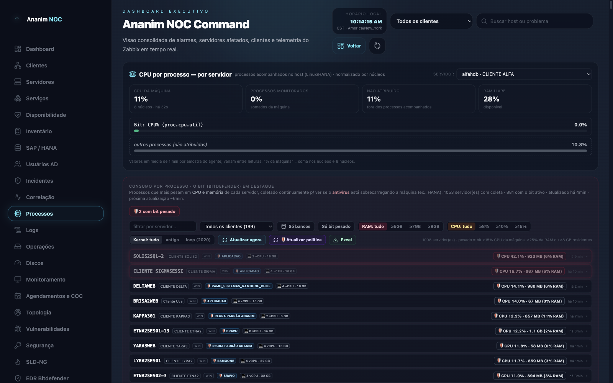

- Principais processos por servidor, normalizados pelo número de núcleos (Linux/HANA), com histórico.
- Hosts Windows mostram cartões por processo (ex.: motor do EDR), separando carga da aplicação de carga do agente de segurança.

### 12. Logs dos servidores

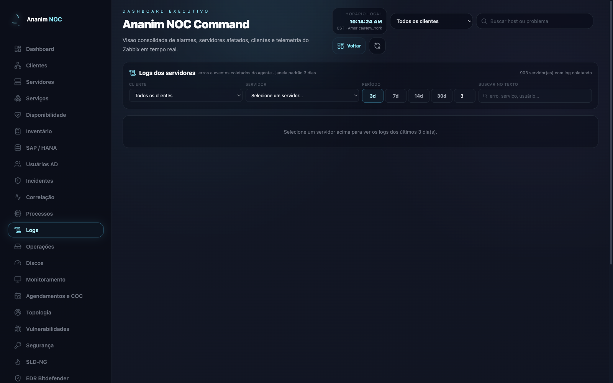

- Erros e eventos coletados pelo agente (Application/System/Security do Windows, logs Linux), janela padrão de 3 dias.
- Sinaliza servidores com leitura de log bloqueada, deixando os pontos cegos visíveis.

### 13. Operações remotas

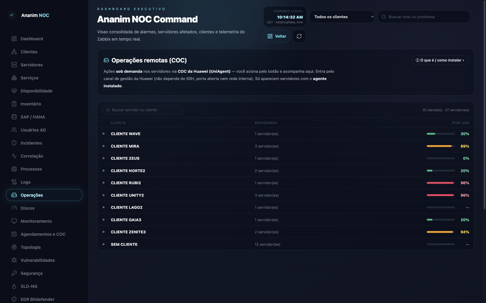

- Ações sob demanda nos servidores pelo agente de gestão do provedor cloud — sem SSH, porta aberta ou rede interna.
- Agrupado por cliente com o pior uso de disco do grupo; resultado acompanhado no portal.

### 14. Discos

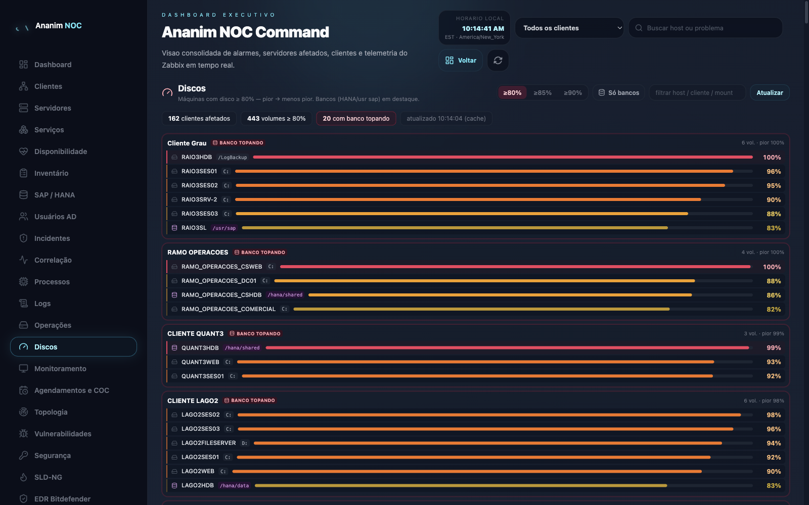

- Todos os volumes ≥ 80 % (ou 85 / 90 %), do pior para o melhor, agrupados por cliente.
- Volumes de banco (`/hana/data`, `/hana/shared`, `/LogBackup`, `/usr/sap`) destacados como "banco topando".

### 15. Cobertura de monitoramento

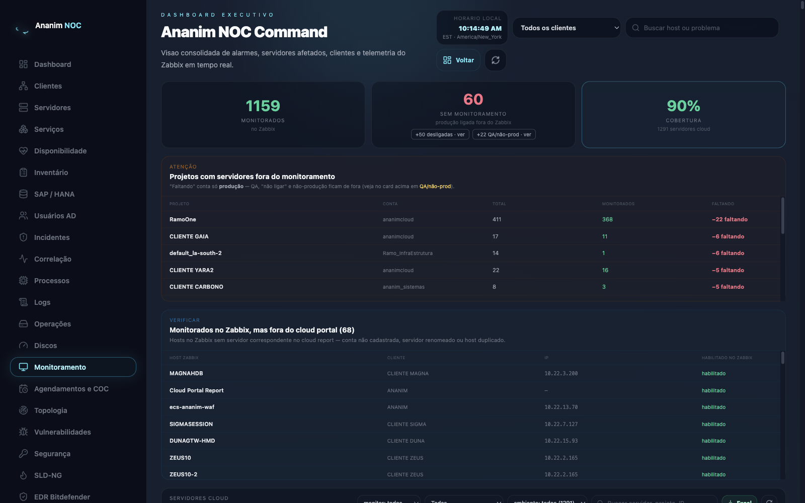

- Servidores na nuvem × hosts monitorados: % de cobertura, máquinas de produção ligadas sem monitoramento, por projeto e conta.
- A verificação inversa também: hosts monitorados sem servidor correspondente na nuvem (fantasmas e sobras).

### 16. Agendamento unificado

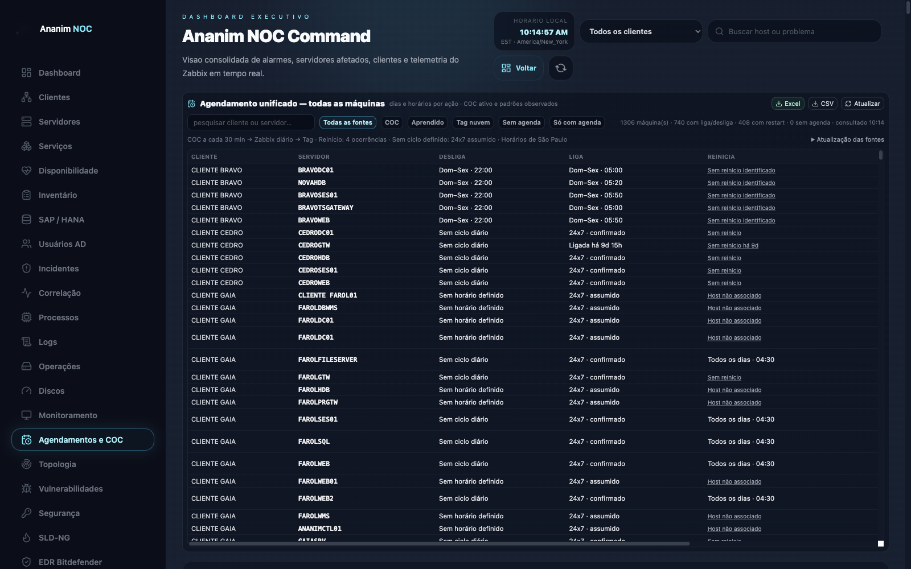

- Uma tabela com dias e horários de desliga / liga / reinicia de todas as máquinas.
- Fontes combinadas e identificadas: agendamentos da nuvem, padrões **aprendidos** pela telemetria e tags; sem ciclo definido = 24×7.
- É o que alimenta a disponibilidade e a supressão de alertas. Exportação Excel / CSV.

### 17. Topologia de rede

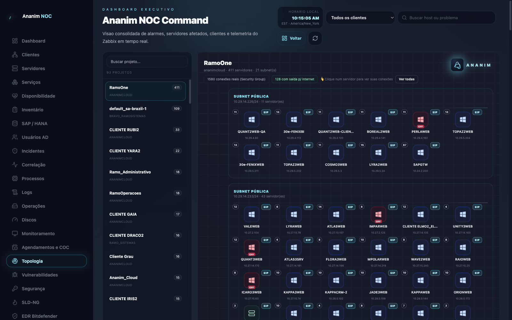

- Mapa projeto → sub-rede → servidor montado pela API da nuvem, com IPs públicos e saída para internet.
- Conexões permitidas reais derivadas das regras de Security Group; clique num servidor para ver as conexões.

### 18. Postura de segurança

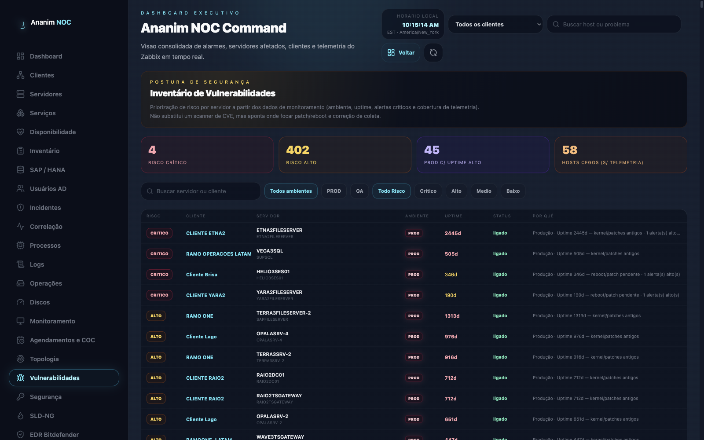

- Priorização de risco por servidor a partir do monitoramento: ambiente, uptime muito alto (patch/reboot pendente), alertas críticos e hosts sem telemetria.
- Explica *por que* cada servidor é crítico/alto. É apoio à priorização, não um scanner de CVE.

### 19. Auditoria da nuvem (credenciais e acessos)

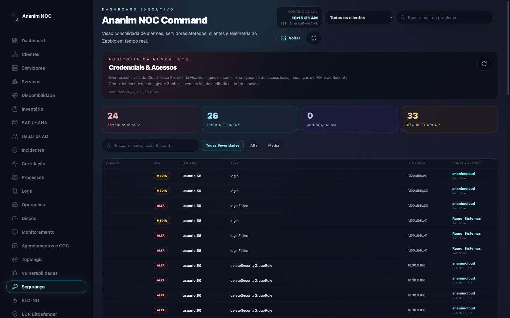

- Eventos sensíveis da trilha de auditoria da nuvem: logins e falhas de login na console, access keys, mudanças de IAM e de Security Group.
- Severidade, usuário, ação, IP de origem e conta/projeto; independente do agente de monitoramento.

### 20. Proteção contra força bruta RDP

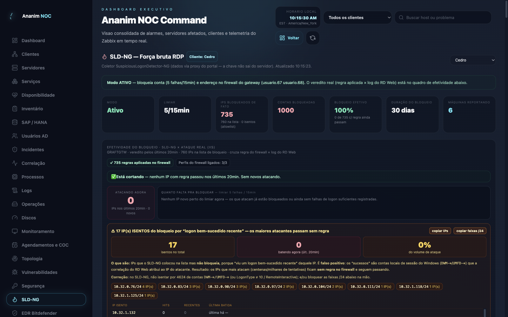

- Painel de um detector de força bruta RDP: modo, limiar (falhas por janela), IPs bloqueados no firewall do gateway, contas bloqueadas, duração do bloqueio.
- **Prova de efetividade**: regras do firewall × log real do RD Web (IIS) — mostra se os IPs bloqueados estão de fato sendo cortados.
- Visões "atacando agora" e "quanto falta para bloquear".

### 21. Postura de EDR

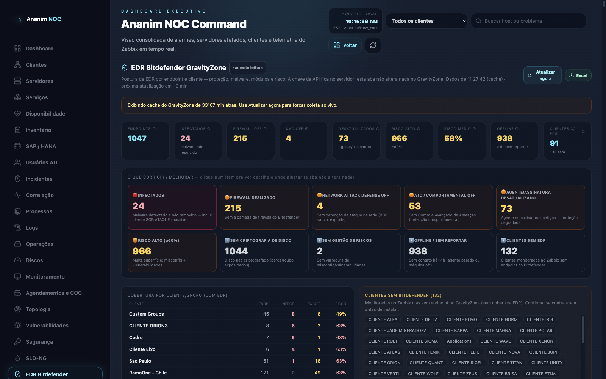

- Postura de EDR somente leitura por endpoint e cliente: infectados, firewall desligado, defesa contra ataque de rede desligada, proteção comportamental desligada, desatualizados, offline, nota de risco.
- Lista "o que corrigir" com onde ajustar; a chave da API fica no servidor e a aba nunca altera o console do EDR. Exportação Excel.

### 22. VPN

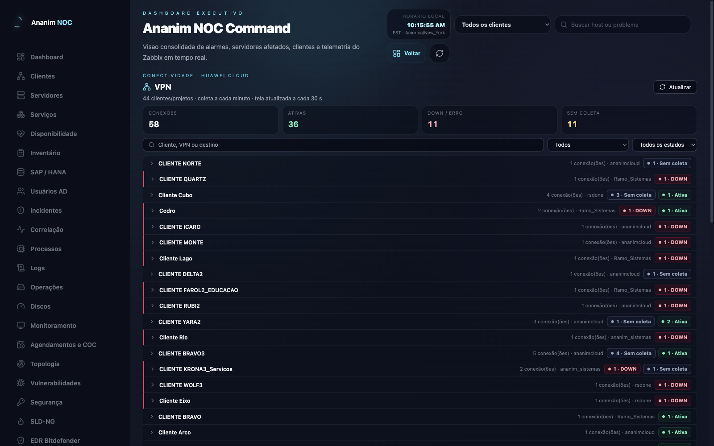

- Conexões VPN site-to-site de todos os clientes/projetos: ativas, down/erro, sem coleta.
- Coleta a cada minuto, tela atualizada a cada 30 s; filtros por cliente e estado.

### 23. Gestão de DNS

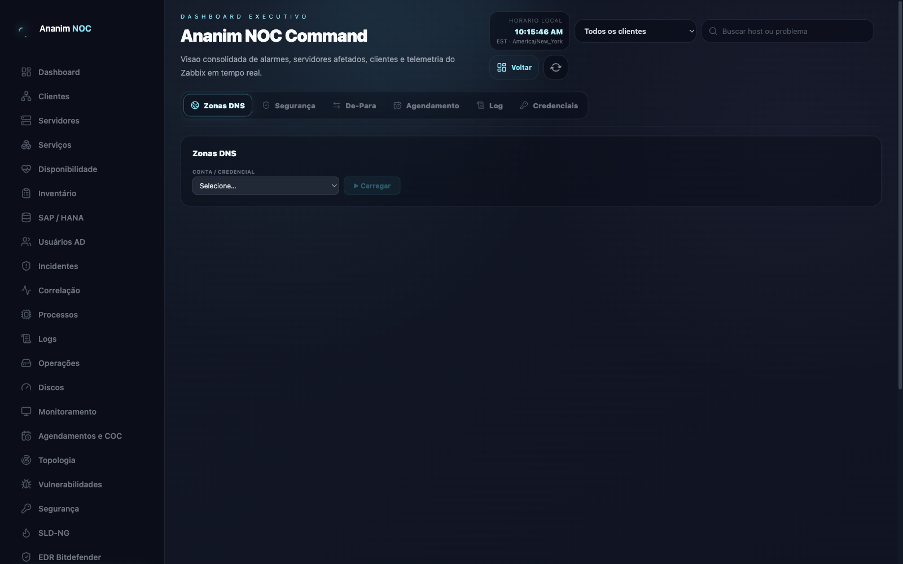

- Zonas DNS de provedores externos (ex.: Route 53), verificações de segurança, mapeamento registro ↔ servidor, alterações agendadas, log de mudanças e gestão de credenciais.

### 24. Relatórios de backup

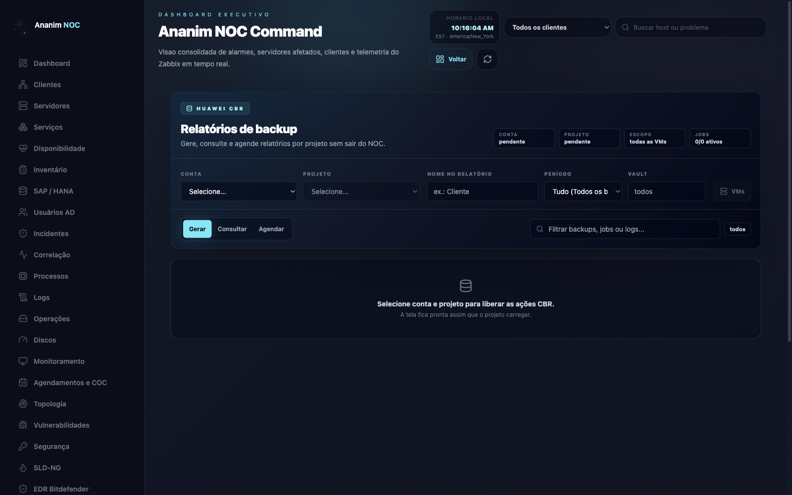

- Gerar, consultar e **agendar** relatórios de backup por conta, projeto, vault e período (último dia … 90 dias, mês atual/anterior) sem sair do NOC.

### 25. Documentação embutida

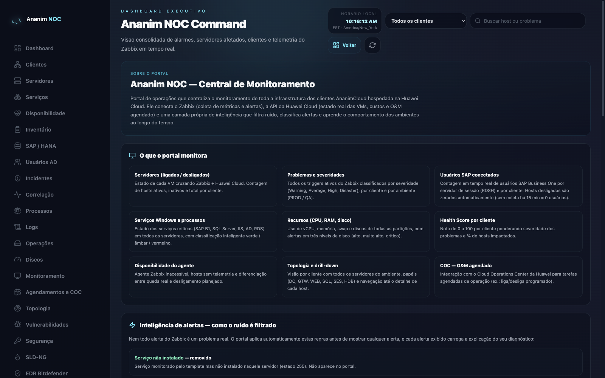

- "Sobre o portal": o que é monitorado, como cada indicador é calculado e seus limites — escrito para operadores e clientes.

## Além das telas

| Recurso | O que faz |
|---|---|
| **E-mails de alerta correlacionados** | E-mail com a marca por incidente, com contexto (cliente, host, papel, agenda), deduplicação, lembrete e mensagem de recuperação. |
| **Relatório do cliente (PDF / PPTX)** | Relatório de utilização por cliente: disponibilidade, CPU/RAM/disco, serviços, backups e usuários — pronto para apresentar. |
| **Exportação em todo lugar** | Excel / CSV / HTML / PDF em disponibilidade, usuários AD, agendamentos, EDR, discos e outros. |
| **Assistente de IA** | Perguntas sobre o ambiente em linguagem natural (só para operadores, nunca no portal do cliente). |
| **Portal segregado + MFA** | Usuários por cliente, MFA TOTP próprio, escopo validado no backend — um cliente nunca vê dados de outro. |
| **Comportamento aprendido** | Aprende a cadência de liga/desliga e os reboots programados de cada host para evitar falsos alarmes de "caído". |
| **Reconciliação de hosts** | Detecta hosts apagados na nuvem que ainda estão no monitoramento e mantém o inventário limpo. |
| **Busca global** | Encontra qualquer cliente, servidor, IP ou serviço de qualquer lugar do portal. |

## Correlação: entender a sequência e o impacto

Alertas, logs e métricas ficam na mesma janela de investigação. Em vez de analisar cada sintoma isolado, o operador acompanha a sequência:

- **Episódios por servidor** — um reboot seguido de várias quedas de serviço é analisado como um episódio.
- **Recorrência** — alertas que se repetem, distribuição no tempo e cadência, para achar problemas crônicos.
- **Diagnóstico por papel** — se o servidor é SAP, HANA, SQL, Active Directory ou RDS, isso orienta as hipóteses e verificações.
- **Impacto nos usuários** — usuários e sessões ao longo do tempo comparados com alertas, CPU, memória, paginação e reinícios de serviço.
- **Operação esperada** — padrões de liga/desliga e reinícios programados separam rotina de evento inesperado.
- **Evidências** — horários, logs e métricas ficam junto da hipótese. Proximidade no tempo não prova causa.

## Como funciona

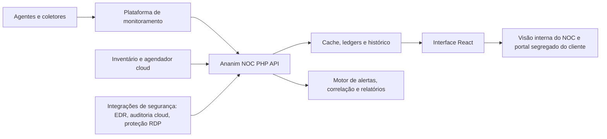

**Stack:** React · TypeScript · Vite · PHP · APIs de monitoramento (Zabbix) · MySQL para histórico · PowerShell · Linux / Windows · APIs cloud (Huawei Cloud) · integrações de EDR e auditoria.

Decisões e limites de arquitetura: [ARCHITECTURE.md](ARCHITECTURE.md) · Evolução: [ROADMAP.md](ROADMAP.md) · Sobre as imagens: [VISUALS.md](VISUALS.md)

## Exemplo de uso

Usuários relatam desconexões do SAP. A equipe seleciona o cliente e o período, identifica os servidores de sessão e compara a queda de usuários conectados com memória, paginação, reinícios de serviços e eventos Windows. Verifica se houve reboot programado, agrupa os sintomas do mesmo episódio e registra a hipótese com as evidências. O relatório separa o impacto observado da causa ainda em validação.

## Competências demonstradas

- Transformar necessidades operacionais em um produto usado diariamente por uma equipe de NOC.
- Integrar muitas fontes de dados preservando o significado de cada sinal.
- Desenho multi-tenant: controle de acesso, MFA, escopo validado no backend, auditoria.
- Interfaces que apoiam diagnóstico e decisão, não só exibição.
- Documentação honesta de trade-offs, validação e limites.

## Limites importantes

- A visibilidade depende de coletores ativos, permissões e retenção das fontes.
- Logs de sessão não mostram quais arquivos foram abertos ou quais operações foram feitas no ERP.
- Correlação temporal ajuda a investigar; não substitui análise de causa-raiz.

## Código-fonte

O código-fonte é mantido em repositório privado. Este repositório é um portfólio: apenas documentação e imagens — sem código operacional, credenciais, acesso a ambientes ou dados de clientes. Marcas e componentes de terceiros permanecem sujeitos aos respectivos direitos e licenças.

## Projetos relacionados

- [Ananim NOC](https://github.com/gsouzacloud/ananim-noc-portfolio) — operação, correlação, usuários e segurança
- [AnanimCloudReport](https://github.com/gsouzacloud/ananim-cloud-report-portfolio) — FinOps e governança cloud
- [Ananim Shield](https://github.com/gsouzacloud/ananim-application-shield-portfolio) — WAF e segurança de aplicações

[Gustavo Souza no GitHub](https://github.com/gsouzacloud) · Documentação atualizada em 18/11/2026.
